# Terrain quality and hazard mapping with Silvanus

IFRoS Robotics Lab, ELTE, autumn 2026. Muhammad Yamin, Praveen Kumar Murali, Aritra Das.

Silvanus (an AgileX Scout 2.0 with an xArm6) drives over indoor floors and outdoor paths. A RealSense D435 on the arm wrist looks at the ground about a metre ahead and measures holes, bumps, cracks and how uneven the surface is. An Xsens IMU on the chassis measures what the wheels actually felt when the robot drove over the same spot. Both are stamped with position and speed so they can go on a map, and the robot will slow down before hazards.

The short version: **the camera predicts, the IMU confirms.**

<p align="center">
  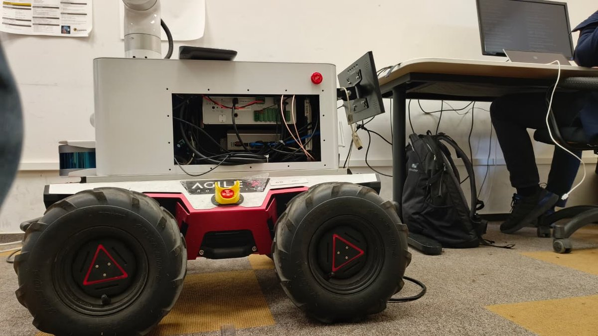
</p>

*Last updated 9 November 2026, week 6 of 8. Final presentation at the end of November.*

---

## Progress at a glance

| Week | Goal | Status |
|---|---|---|
| 1 (1-7 Oct) | Depth hazard node running on the robot | Done, checked live and on bags |
| 1 | IMU mounting measured, transform published | Done, IMU raised from 10 to 100 Hz |
| 1 | First outdoor recordings with a surface log | Done, 5 outdoor runs with labelled surfaces |
| 1 | Robot body and gripper mask | Done: depth mask, and the colour mask in the crack node |
| 2 (8-14 Oct) | Outdoor localization tested | Done offline, wheel speed + IMU heading works best |
| 2 | Crack model trained and released for the robot | Done, model v1 running in the crack node on our recordings |
| 2 | Indoor map with SLAM, Nav2 to a goal on it | Done 27 Oct: the corridor loop closes to 1 cm, the robot drives to goals from RViz |
| 2 | IMU roughness | Done 9 Nov: node publishes the fast/slow band ratio on `/terrain/imu_roughness`; checked on bag replay (section 3) |
| 2 | RGB terrain classifier | Done 9 Nov: 99.5 % of frames right on runs it never saw, five surfaces (section 3); ROS node tested on a bag; class mask per patch for the Nav2 costmap (11 Nov) |
| 2 | Annotation of our own crack frames | In progress |
| 3 (15-21 Oct) | Zigzag coverage sweep | First sweep on the robot 27 Oct, Nav2 through the governor; its stall at a lane change is fixed and checked in simulation |
| 3 | Speed governor: slow down so the IMU can feel a hazard, stop before obstacles | Live on the robot 27 Oct: slows to 0.2 m/s, feels 10-74 mm plates, stops for walls and tall objects |
| 3 | Camera and IMU fused, hazard classes A/B/C | Done offline on our recordings (section 6), live in the governor |
| 4 (22-28 Oct) | Fully autonomous: live map, lanes planned by the robot, sweep | First robot try 28 Oct: everything starts from one script, but no lane was driven; the causes are fixed and checked in simulation |
| 4 | Inspection page updating live on the laptop | Ran on the robot 28 Oct: the laptop showed the floor and a 17 mm wooden block |
| 4 | Labelled outdoor runs with repeats | Open |

Full plan to the end of November: [docs/MILESTONES.md](docs/MILESTONES.md).

---

## 1. Hazards from the depth camera

Every depth frame gets a ground plane fitted with RANSAC. Each point then has a height above or below that plane. Points far enough above it are bumps, points below it are holes, and each one is measured: length, width and height.

<p align="center">
  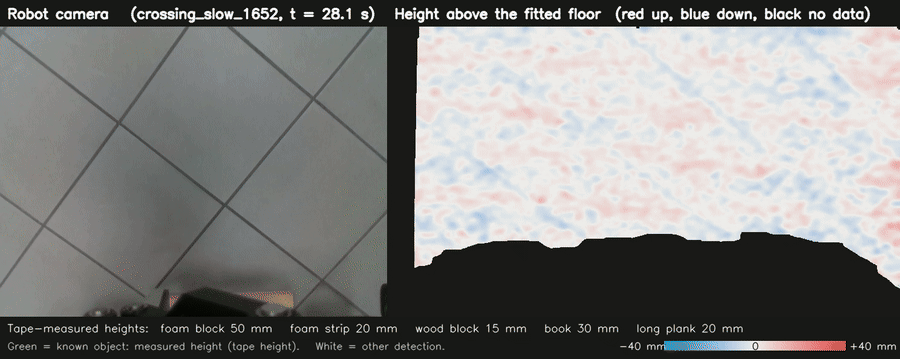
</p>

Left: the robot camera. Right: the height of every point above the fitted floor, red up and blue down. The green boxes are detections, labelled with the measured height and the height from a tape measure. Full 37 s clip: [crossing_detection.mp4](docs/media/crossing_detection.mp4).

We placed five objects on the corridor floor, measured each with a tape, and drove over them 24 times across 3 runs:

| Object | Tape size (L x W x H) | True height | Camera |
|---|---|---|---|
| Foam block | 25.5 x 20.5 x 5 cm | 50 mm | 47 mm |
| Book | 20 x 14 x 3 cm | 30 mm | 26-27 mm |
| Foam strip | 94-96 x 20 x 2 cm | 20 mm | 19-21 mm |
| Long wooden plank | 111 x 8.2 x 2 cm | 20 mm | 18-20 mm |
| Wooden block | 31.5 x 6.5 x 1.5 cm | 15 mm | 15-19 mm |

The mean error is 1.7 mm and the worst is 4.3 mm. The same object measures the same within 1-2 mm on every pass and at both speeds. The gripper sits at the bottom of every depth frame, so it is masked out; that removed the false bumps it used to cause.

<details>
<summary>Each object on a typical frame (click to open)</summary>
<p align="center">
  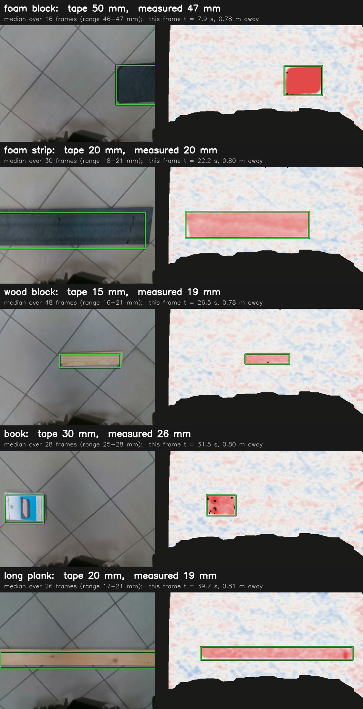
</p>
</details>

Code: [ground_demo/](ground_demo/README.md). Details and the history of the fixes: [ground_demo/BRANCH_NOTES.md](ground_demo/BRANCH_NOTES.md).

## 2. The camera predicts, the IMU confirms

<p align="center">
  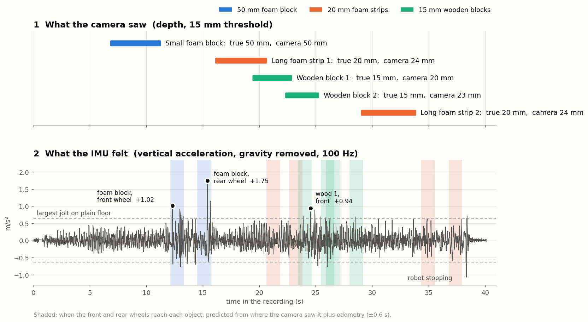
</p>

The camera sees each object about 4 seconds before the wheels reach it. From where it saw the object and the odometry, we can predict when the front wheels and then the rear wheels will hit it (shaded bands). On the 50 mm foam block the IMU shows the two largest jolts of the run exactly in those bands. That is the first confirmed hazard.

What else the crossing runs showed:

- At 0.2-0.3 m/s the IMU feels rigid objects from 15 mm (the wooden blocks).
- It never feels the 20 mm foam, because foam squashes under the tyre. This is a result: some hazards the camera sees are harmless for this robot.
- Above about 0.4 m/s the robot's own shaking on tile hides every object. The IMU can only confirm a hazard if the robot slows down near it, which is what the speed governor is for.

**Height against jolt, per crossing.** On the two crossing runs the camera measures every object within 4 mm of the tape. For each pass we checked which wheel ran over the object and how hard the IMU jolted. The jolt does not grow with height here (rho = 0.00 over 17 passes, heights 15-47 mm); it grows with speed (rho = 0.87 for the rigid objects). Foam strips were felt on some passes at 0.26-0.42 m/s, and objects passing between the wheels are not felt. The next recordings at 0.2, 0.3 and 0.4 m/s need rigid objects of several heights in a wheel track, to give a height-jolt curve per speed. Details: [docs/surface_roughness.md](docs/surface_roughness.md#crossings-bump-height-against-the-imu-jolt).

<p align="center">
  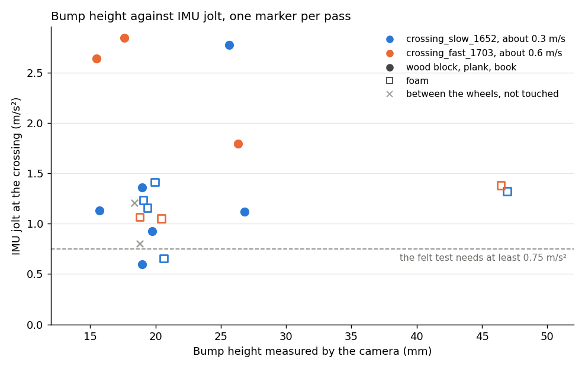
</p>

## 3. Outdoor surfaces

<p align="center">
  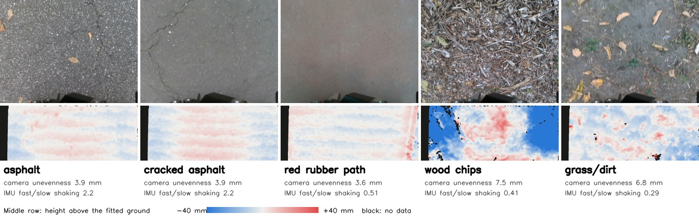
</p>

Top: the robot camera. Middle: height above the fitted ground on the same frame. The numbers are medians over all runs.

| Surface | Camera unevenness | IMU fast/slow shaking |
|---|---|---|
| Asphalt (plain and cracked) | 3.9 mm | 2.2 |
| Red rubber path | 3.6 mm | 0.51 |
| Wood chips | 7.5 mm | 0.41 |
| Grass / dirt | 6.8 mm | 0.29 |

Camera unevenness is the RMS height of the ground points around the fitted plane. The indoor tile floor reads 3.4-3.7 mm, which is the depth camera's own noise, so asphalt and the red path are as flat as the camera can tell, while grass and wood chips are clearly rougher. Depth works in daylight: 96 % of pixels are valid and the ground plane is found in every frame.

The planned IMU roughness number, the RMS of vertical acceleration, did **not** separate surfaces: on all of them it is about 1.0 times the speed. What does separate them is which frequencies shake. We take the power at 8-50 Hz divided by the power at 0.5-8 Hz, at matched speed. Hard asphalt shakes fast, soft ground shakes slow. This only works with the IMU at 100 Hz. With one threshold, asphalt vs grass is 97 % correct from the camera and 91 % from the IMU.

One whole outdoor run, the driven path and both roughness numbers along it. Both change when the surface changes:

<p align="center">
  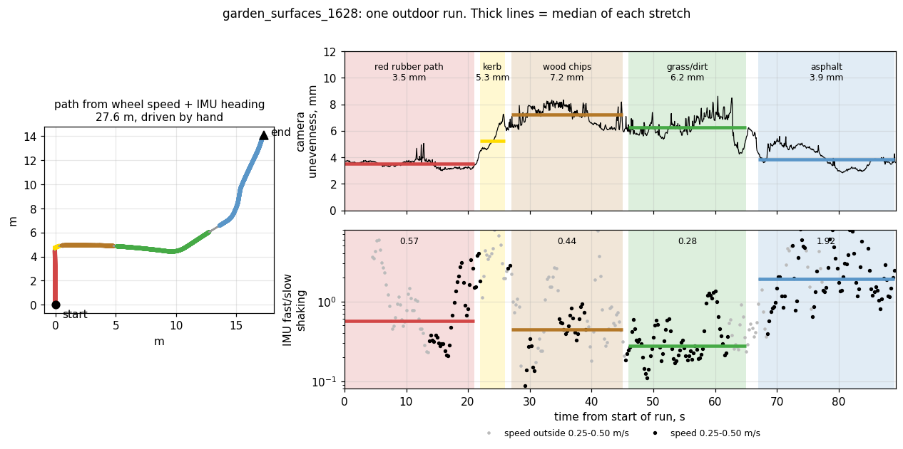
</p>

Videos: [the run with detections and height map](docs/media/outdoor_run_1628.mp4) (90 s), [the robot outdoors from a phone](docs/media/robot_outdoor_1618.mp4).

On grass and wood chips the fixed 15 mm bump threshold also boxes tufts and leaves as 12-19 mm bumps. Off pavement, the threshold has to follow the unevenness of the surface.

### Which surface: the RGB terrain classifier

Depth and the IMU say how rough the ground is. The colour camera adds what the surface is: asphalt, red rubber path, wood chips, grass/dirt or indoor tile. A small pretrained network (MobileNetV3-small) looks at six ground patches above the robot mask in each frame and averages them into one answer per frame. It was trained on our own outdoor and indoor recordings and tested on runs it never saw:

| Surface | Test frames | Accuracy |
|---|---|---|
| Asphalt | 100 | 100 % |
| Red rubber path | 52 | 100 % |
| Wood chips | 44 | 95.5 % |
| Grass / dirt | 61 | 100 % |
| Tile (indoor) | 130 | 100 % |

387 frames from four held-out runs, 99.5 % right. Over a whole held-out run, boundaries included, it follows every surface change within a few seconds, and its confidence drops where two surfaces meet:

<p align="center">
  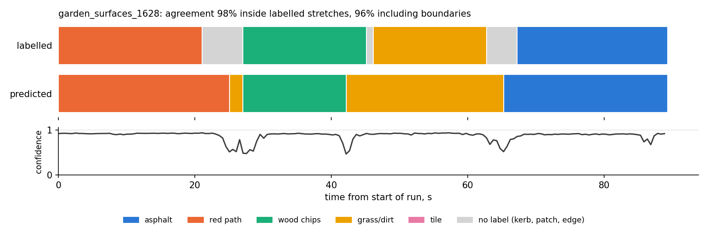
</p>

Which surface it confused with which, on the held-out runs 1628 (outdoor) and 1447 (indoor tile). The two wood-chip frames called grass/dirt are at the end of the wood-chip stretch, where the chips thin out into dirt:

<p align="center">
  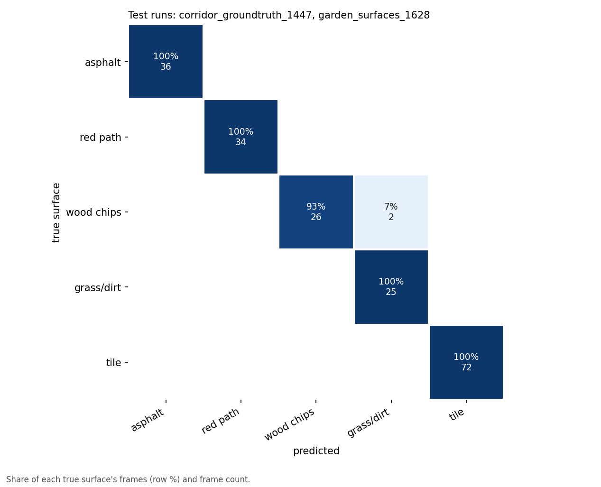
</p>

The surfaces are visually distinct and all outdoor runs were recorded on one afternoon, so this shows the classifier works on our recordings, not yet on other days or surfaces. On a run with ground it has no class for, it calls smooth concrete "asphalt" with high confidence. A metal drain grate gets low confidence, so the node publishes `unknown` there. Details, both folds and the confusion matrix: [docs/terrain_classifier.md](docs/terrain_classifier.md).

For the Nav2 costmap the classifier also gives a class per patch instead of one per frame (`predict_mask()`), so the robot sees where one surface ends and the next starts. At the change from wood chips to dirt, four patches say grass/dirt, one is unsure and is left unknown:

<p align="center">
  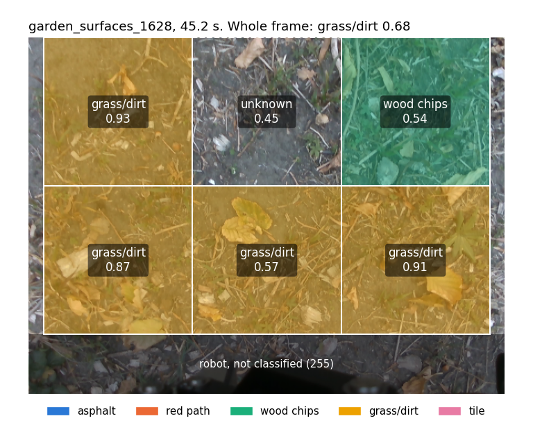
</p>

### Roughness per surface, camera against IMU

One value per 0.25 m of driven path over six recordings, with the checked surface labels. Left: what the camera measures ahead of the robot. Right: what the IMU feels under the wheels (fast/slow shaking, from the new IMU roughness node):

<p align="center">
  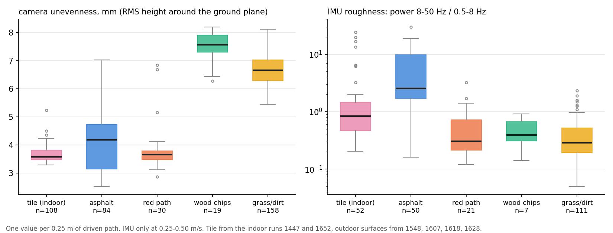
</p>

The camera separates flat ground (tile, asphalt, red path, 3.6-4.2 mm) from uneven ground (grass/dirt, wood chips, 6.7-7.6 mm). The IMU separates hard from soft: asphalt shakes fast, grass and wood chips slowly. Against each other, per 0.25 m, the two form two groups rather than a line (Spearman rho = -0.54):

<p align="center">
  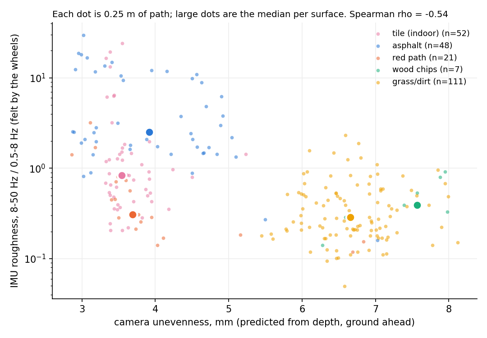
</p>

So the two measure different things, shape and hardness, and together they tell the surfaces apart better than either alone. The band ratio is not the IMU number to check the camera's bump predictions against; for that we use the jolt when the wheels cross an object (section 2). Details: [docs/surface_roughness.md](docs/surface_roughness.md).

## 4. Cracks

Depth cannot see thin cracks (the D435 noise is a few millimetres), so cracks come from the colour image with a segmentation network.

We trained a small U-Net (1.9 million parameters) on two public crack datasets, DeepCrack and CrackForest. Crops of the same photo never end up in both training and test; in DeepCrack they did at first, and fixing that dropped the validation score from 0.81 to 0.57 on a quick test run, so the original number was inflated.

| | Dice | IoU | Precision | Recall | F1 with 2 px tolerance |
|---|---|---|---|---|---|
| Public test set, 255 images | 0.833 | 0.714 | 0.908 | 0.770 | 0.912 |

A model four times larger scored the same and ran three times slower, so we kept the small one. On a laptop CPU it takes about 0.2 s per 640x480 frame, which is enough: the camera sees each spot for several seconds before the robot reaches it.

The first crack node ran in simulation with a simple dark-pixel threshold:

<p align="center">
  
  
</p>

The threshold also boxed the robot's own bumper and wheels, so the node now runs the U-Net instead (Aritra, [src/crack_detection](src/crack_detection/README.md)): up to 5 frames a second on the robot's camera, with a colour mask for the gripper, and with the crack pixels put in 3D through the depth image. Replayed on our recordings it finds cracks in 100 % of the cracked-asphalt frames. It also marks tile grout and the edges of kerbs and door steps, so two filters drop long straight lines and crack pixels on a height step: 97 % of the tile grout goes, 96 % of the real crack pixels stay. Still to do: fine-tuning on our own annotated frames, with tile as "no crack" examples. Model card and steps: [docs/crack_model.md](docs/crack_model.md). Training code: [vision_training/](vision_training/README.md).

## 5. Where the robot is: localization

| Option | Result |
|---|---|
| GNSS | A fix in 3 of 5 runs, about ±7-10 m. Too coarse for hazard positions |
| Wheel odometry | Misjudges turns by 15-30° per run (skid steer) |
| **Wheel speed + IMU heading** | **Best so far.** A 26 m indoor out-and-back ends 0.70 m from the start (wheels alone: 4.74 m). A 35 m outdoor loop ends 0.37 m from the start (wheels: 0.97 m) |
| Lidar SLAM (lab config) | Fails indoors and outdoors with the current scan, see below |

<p align="center">
  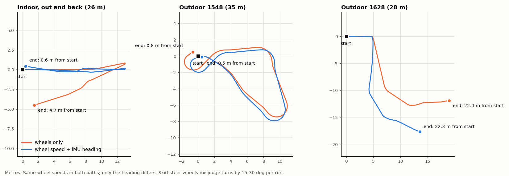
</p>

Same wheel speeds in both paths, only the heading differs. The figure is the offline comparison; the same fusion runs in ROS with `robot_localization` ([config/ekf_odom_imu.yaml](config/ekf_odom_imu.yaml)). To run it live, the base driver must stop publishing its own odometry transform, which the lab launch does not allow yet.

**Why SLAM fails.** The 2D scan is cut from the 3D lidar using all points between -0.10 and +0.60 m above the floor, so it includes the floor itself. The lowest beam hits the floor 1.4 m away, and indoors 80 % of the scan becomes a ring of floor around the robot. The ring moves with the robot and looks the same everywhere, so SLAM decides the robot is not moving.

<p align="center">
  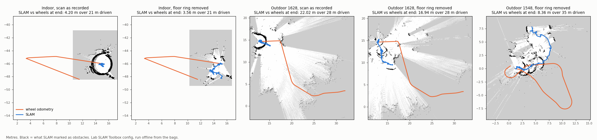
</p>

The fix is to raise the scan's minimum height to about +0.10 m indoors (+0.15 m outdoors) in the lab bring-up, and to record the 3D lidar so scans can be remade offline.

## 6. Everything on one map

All of it on one bag, offline: bumps and holes from depth, cracks from the U-Net, roughness along the path, all placed with the wheel + IMU position. Each hazard gets its class by checking whether the IMU jolted when a wheel crossed it.

<p align="center">
  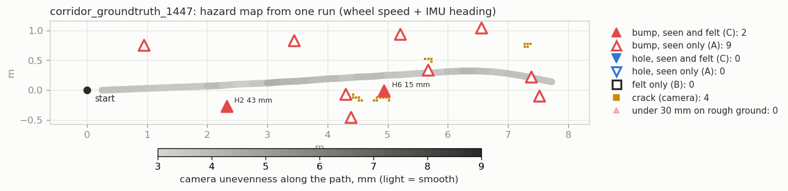
</p>

On the tape-measured run the 50 mm foam block and a 15 mm wooden block are seen and felt (class C); the 20 mm foam strips are seen only (A), because foam squashes under the tyre. Outdoors the map shows the kerb, the raised edges of the red rubber path and the cracks on the asphalt: [hazard_map_1628.png](docs/media/hazard_map_1628.png). Details, fixes and limits: [docs/PROGRESS.md section 5](docs/PROGRESS.md#5-everything-on-one-map). Script: [tools/analysis/hazard_map.py](tools/analysis/hazard_map.py). For whoever fixes the ground, the same runs become an inspection map. The camera looks almost straight down, so its frames are laid flat on the ground and stitched into one photo of the driven strip at 5 mm per pixel, with the cracks drawn on it:

<p align="center">
  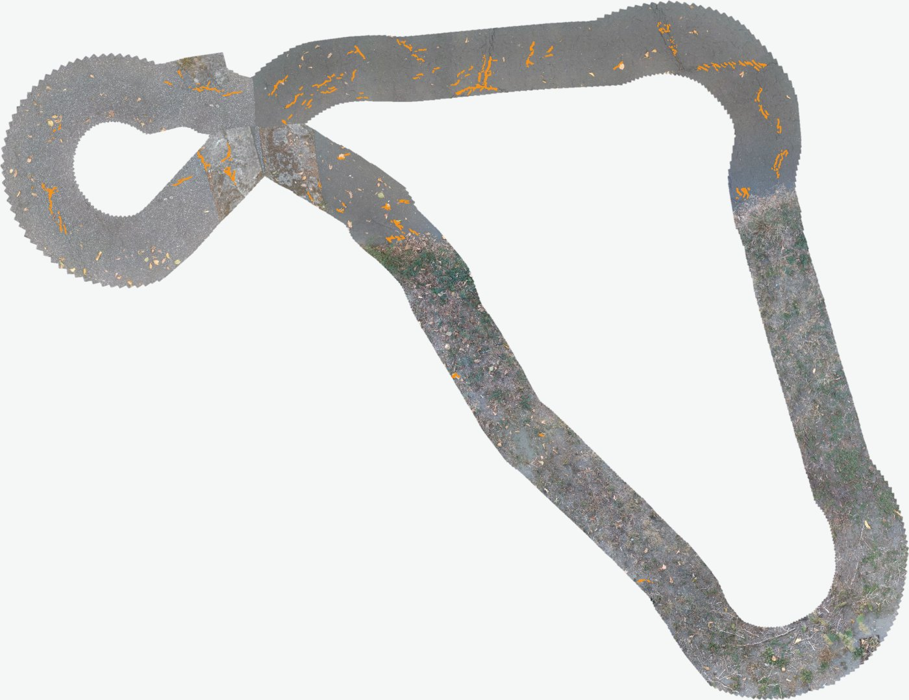
  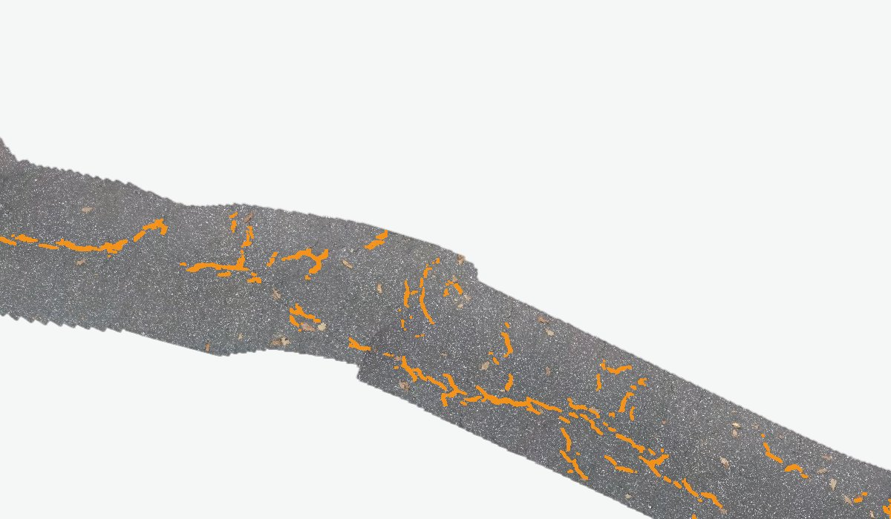
</p>

Left: the 35 m garden loop, asphalt at the top, grass below, 18 m of cracks in orange. Right: the cracked asphalt at the end of another run. A viewer page adds a work list sorted by priority, with a photo of each item and where to find it (metres along the route, left or right). To open it from your copy of the repository:

```bash
cd tools/inspection_viewer && python3 -m http.server 8000      # then open http://localhost:8000
```

Details: [tools/inspection_viewer](tools/inspection_viewer/README.md).

On the robot the same idea runs live in the speed governor ([navigation/](navigation/README.md#speed-governor)): it slows to 0.20 m/s before every hazard on the wheel track so the IMU can feel it, stops for anything of 10 cm or more right in front or a lidar obstacle 40 cm from the bumper, and reports each hazard as felt (C) or not (A) once the rear wheels are past. On 27 October it did all of that live, with teleop and then under Nav2 in a first sweep of the corridor. That sweep is the newest run in the viewer, placed with the lidar map underneath and the route in orange where the robot slowed:

<p align="center">
  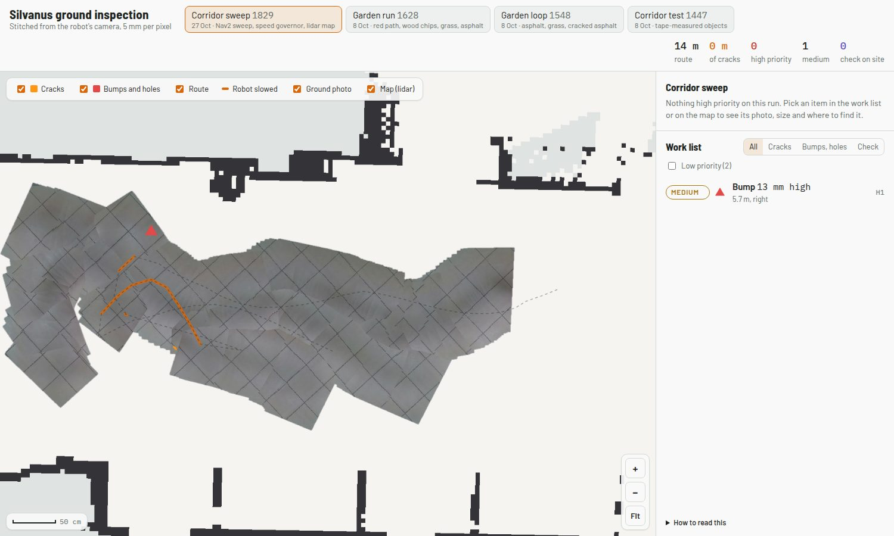
</p>

The next step runs without a saved map and without a driver: live SLAM, one turn on the spot, lanes planned in the free floor the robot has mapped, the sweep through the governor, and the same page updating on the laptop while it drives ([docs/PROGRESS.md section 6](docs/PROGRESS.md#6-on-the-robot-map-nav2-the-governor-and-the-first-sweep-27-october)).

## 7. Known problems

| Problem | Effect | Next step |
|---|---|---|
| The 2D scan contains the floor | SLAM and Nav2 unusable | Done: our scripts start `/scan_fixed` without the floor; the lab bring-up still has the old scan |
| Fixed depth threshold outdoors | Tufts and leaves boxed as 12-19 mm bumps | Done: the threshold follows the surface's unevenness (section 6) |
| D435 drops off USB | Happened 5 times on 8 October, after fast or rough driving | Secure the cable; reported to the lab |
| Wheel odometry heading | 15-30° error per run | Fuse the IMU heading (EKF, ready) |
| GNSS | ±7-10 m, no fix in 2 of 5 runs | Rough placement only |

## 8. Next weeks

- **Week 3, done.** Crack U-Net in the robot's crack node with false-crack filters; camera and IMU fused into one map with the A/B/C classes; inspection map; speed governor, tested offline.
- **Week 4, done.** At the robot: the scan fix, the indoor map with SLAM, Nav2 to goals, the speed governor live, a first sweep through it, a first try of the autonomous session with the live page.
- **Week 5.** Everything together, first on one bag (done: the corridor sweep, section 6) and then live: the robot drives a lane by itself over a block, slows, crosses it, the IMU spike is logged and a confirmed marker appears on the live page. The parts all work on the robot; one autonomous run with all of them together is next. Still open from week 4: crossing runs at 0.2, 0.3 and 0.4 m/s, and labelled outdoor runs with repeats.
- **Week 6, now.** RGB terrain classifier done (99.5 % on held-out runs, section 3) and its ROS node tested on bag 1628; crack model v2 from our own annotated frames, with tile grout as "no crack" examples, tested against v1 on the two test runs.
- **Weeks 6-8.** Repeat runs, roughness vs speed, the camera unevenness vs IMU roughness comparison, hazard counts per class, the smallest hazard the robot feels, demo video and presentation.

Every hazard will end up in one of three classes, which is the main result of the project:

| Class | Camera saw it | IMU felt it | Meaning |
|---|---|---|---|
| A | yes | no | Seen, not felt: the wheels missed it, or it is too small for this robot |
| B | no | yes | Felt, not seen: the camera missed it |
| C | yes | yes | Confirmed |

---

## For the team

| Document | What is in it |
|---|---|
| [docs/PROGRESS.md](docs/PROGRESS.md) | Detailed results, robot side |
| [docs/DATA.md](docs/DATA.md) | Every recorded bag, surface labels, how to replay them (bags are on the shared drive) |
| [docs/schema.md](docs/schema.md) | Topic names and message formats |
| [docs/crack_model.md](docs/crack_model.md) | Crack model: files, how to use it in the node, annotation and fine-tuning |
| [docs/terrain_classifier.md](docs/terrain_classifier.md) | RGB terrain classifier: labels, training by held-out run, results, the ROS node |
| [docs/surface_roughness.md](docs/surface_roughness.md) | IMU roughness node, roughness per surface, camera unevenness against IMU roughness, bump height against IMU jolt per crossing |
| [docs/vision_log.md](docs/vision_log.md) | Vision decisions and results, step by step |
| [docs/robot/](docs/robot/) | Arm pose, IMU mount, how to run a robot session |
| [tools/analysis/](tools/analysis/README.md) | Scripts that make every figure on this page |

ROS 2 packages target ROS 2 Jazzy on Ubuntu 24.04 in Docker (`ros:jazzy-ros-base`, the same base as the lab's robot image). The crack training code in `vision_training/` is plain Python and PyTorch:

```bash
cd vision_training
pip install -e ".[onnx,dev]"
python scripts/download_data.py && python scripts/prepare_data.py
python scripts/train.py --config configs/smoke_cpu.yaml
```
