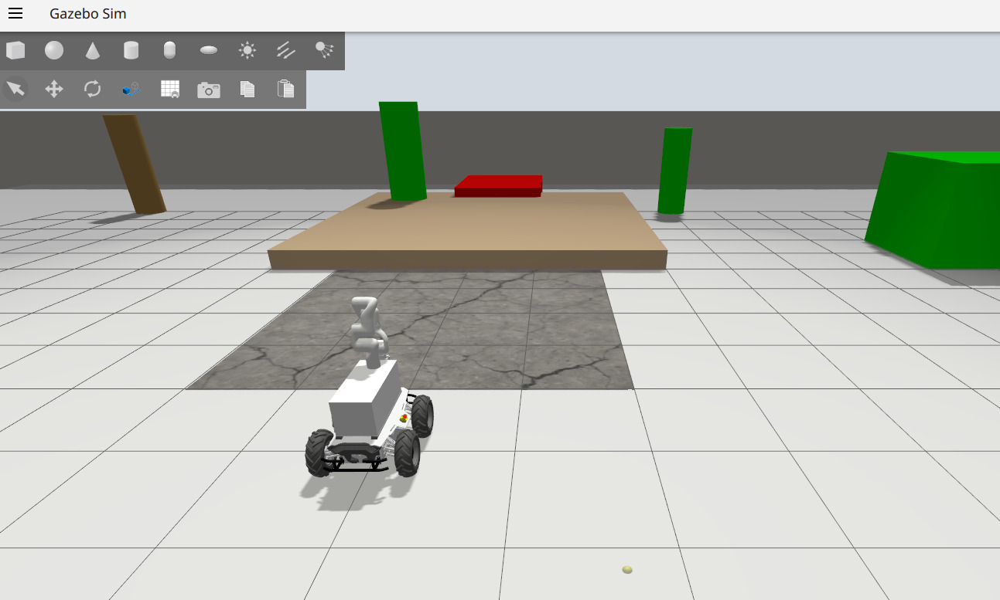
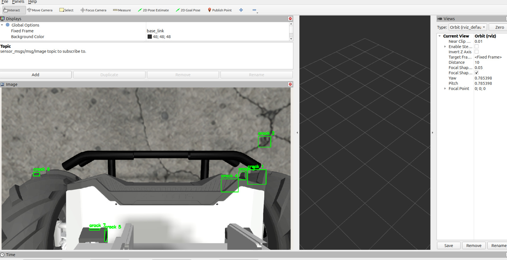
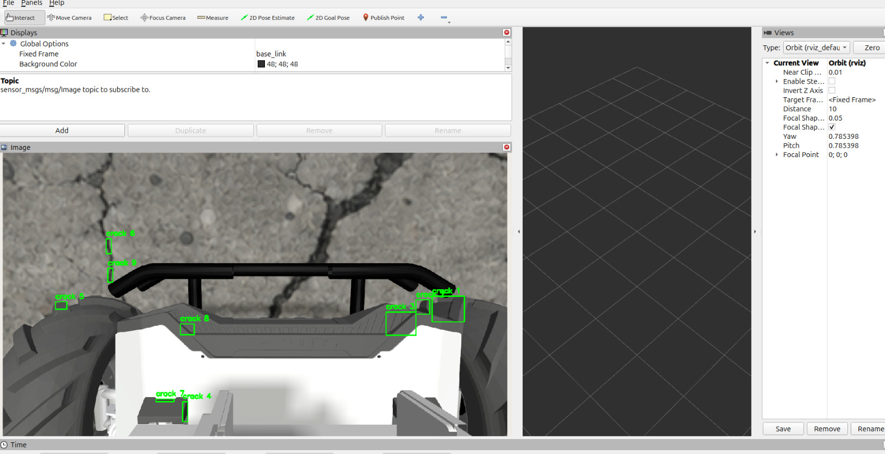
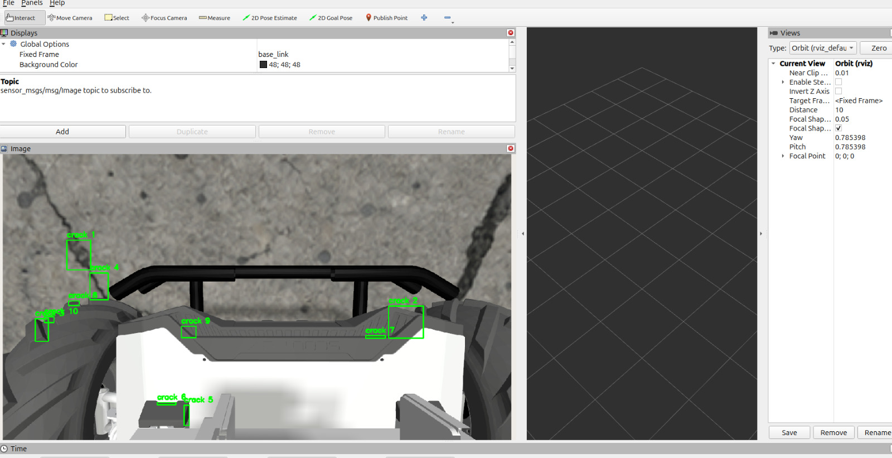

# silvanus-terrain-quality-mapping

Terrain quality and hazard mapping with the Silvanus robot (AgileX Scout 2.0 with a RealSense D435 and an Xsens IMU). IFRoS Robotics Lab, ELTE, autumn 2026.

The robot is driven along a route. The camera looks at the ground ahead and predicts what is coming (holes, bumps, unevenness, cracks, terrain type). The IMU measures what the robot actually felt when it drove over it. Everything is stamped with position and speed and stored on a map, and the robot slows down or stops before hazards. In short: the camera predicts, the IMU confirms.

## Simulation

Silvanus in Gazebo with the arm posed so the wrist camera looks at the ground, driving towards a patch of cracked pavement:

<p align="center">
  
</p>

The camera stream in RViz with the first crack detection node running on it. Each green box is a crack candidate, published as JSON on `/crack_detection/detections` and drawn on `/crack_detection/debug_image`:

<p align="center">
  
  
  
</p>

The lower half of the view is the robot's own front bumper and wheels, and some boxes land there. A fixed mask for the robot body (and later the gripper on the real arm) is one of the next steps, and the learned segmentation model below replaces the dark-pixel threshold.

## Where things stand

**Progress against the milestones, with results, figures and video: [docs/PROGRESS.md](docs/PROGRESS.md).**

<p align="center">
  
</p>

**Depth hazard detection** (`ground_demo/`, branch `praveen-robot-and-depth`). A ROS 2 node that fits the ground plane in every depth frame and reports bumps and holes with their size. Against tape-measured objects from 15 to 50 mm the height is within 1.7 mm on average. The IMU on the robot is now calibrated and runs at 100 Hz, and confirms a 50 mm hazard when the wheels cross it. Recorded data and surface labels: [docs/DATA.md](docs/DATA.md).

**Crack segmentation training** (`vision_training/`, on `main`). A complete offline pipeline in PyTorch: it downloads the public DeepCrack and CrackForest datasets, converts them to one format, splits them so crops of the same photo never land in both train and test, trains a small U-Net, evaluates it with strict and tolerant pixel metrics, and exports it to ONNX for CPU inference on the robot. First CPU check: the exported model runs at about 11 fps on 640x480 frames on a laptop. Real training runs go to a GPU server.

**ROS 2 crack detection node and robot container** (branch `aritra-crack-detection`, to be merged). A `crack_detection` package for ROS 2 Jazzy that subscribes to `/camera/color/image_raw`, finds dark crack-like regions with thresholding, morphology and shape filters, and publishes boxes plus a debug image. All thresholds are ROS parameters. It comes with a Dockerfile built on `ros:jazzy-ros-base`, the same base as the lab's robot image, so the container runs next to the robot's hardware stack. This node produced the screenshots above.

**Next.** Swap the threshold detector for the trained ONNX model, mask the robot body out of the image, and start the depth side: fit the ground plane with RANSAC on the depth image and turn points far below or above it into holes and bumps with a measured size.

## Quick start

Crack segmentation training (plain Python, no ROS needed):

```bash
cd vision_training
pip install -e ".[onnx,dev]"
python scripts/download_data.py
python scripts/prepare_data.py
python scripts/train.py --config configs/smoke_cpu.yaml
```

See [vision_training/README.md](vision_training/README.md) for the full workflow, and [docs/vision_log.md](docs/vision_log.md) for decisions, results and open items on the vision side.

ROS packages target ROS 2 Jazzy on Ubuntu 24.04 inside Docker.
