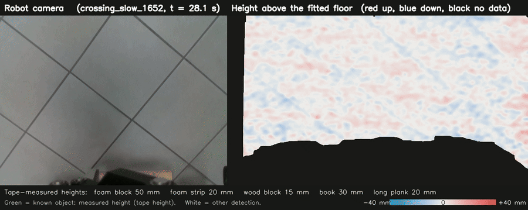
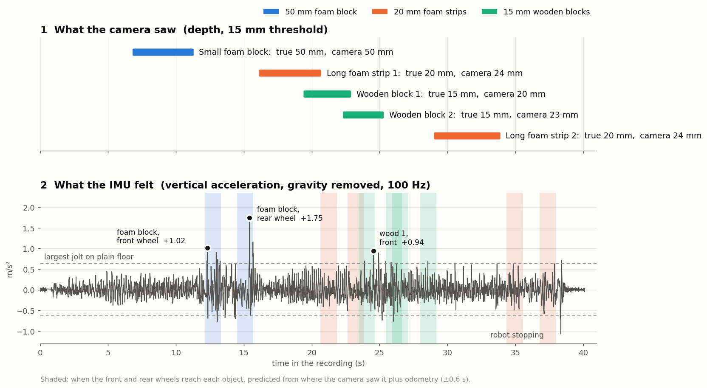
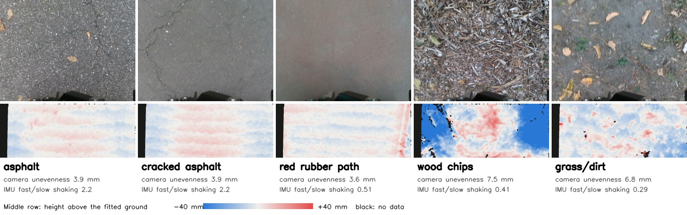
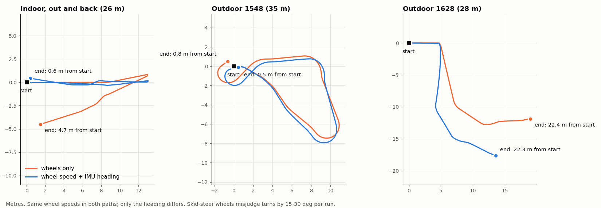
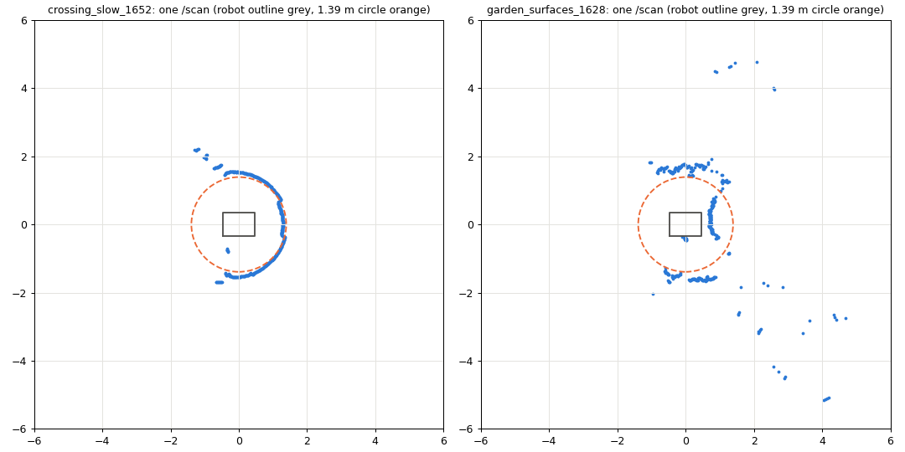
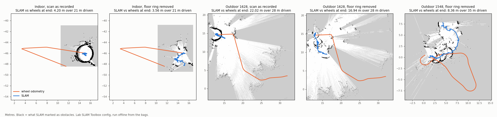

# Progress

Terrain quality and hazard mapping with Silvanus. State on 2026-10-08, against
the plan in [MILESTONES.md](MILESTONES.md). Data: [DATA.md](DATA.md).

---

## Milestones

### Week 1, 1-7 October

| Task | State |
|---|---|
| Depth pipeline running as a ROS 2 node | ✅ `ground_demo/ground_hazard_node.py`, checked live and on bags |
| `xsens_link` to `base_link` transform measured and published | ✅ [imu_mount.md](robot/imu_mount.md); IMU also raised from 10 to **100 Hz** |
| First outdoor bag, with a surface log | ✅ 5 outdoor runs; surfaces labelled from the robot camera and phone video |
| Crack model running on real frames | open; cracked asphalt is in `garden_surfaces_1548` and `_1618` |
| Robot body and gripper mask | ✅ depth mask; the colour-image mask is open |
| Topic names and record schema agreed | draft in [schema.md](schema.md), not yet agreed |

### Week 2, 8-14 October

| Task | State |
|---|---|
| Outdoor localization tested | ✅ done offline, results below |
| Indoor map with SLAM Toolbox, AMCL on it | **blocked**: the lidar scan contains the floor (below) |
| IMU roughness node | the feature that works is found (below); node not written |
| Nav2 configured for the Scout | open |
| RGB terrain classifier, first version | open; 5 labelled outdoor surfaces are ready |
| Annotation from our own bags | open |
| **Gate:** robot drives to a goal on a saved map | not yet, needs the scan fixed first |
| Week 3, started early: zigzag coverage sweep | tool written ([navigation/](../navigation/README.md)); in the lab simulator the skid-steer turns at less than half the commanded rate, so Nav2 cannot follow it yet |

---

## 1. Hazard detection from depth

Left the robot camera, right the height of every point above the fitted floor
(red up, blue down). Boxes are detected hazards, labelled with their size.
Full quality: [crossing_detection.mp4](media/crossing_detection.mp4).

Tested against objects measured with a tape, 24 passes over 3 runs:

| object | true height | measured |
|---|---|---|
| foam block | 50 mm | 47 |
| book | 30 mm | 26-27 |
| foam strip | 20 mm | 19-21 |
| long wooden plank | 20 mm | 18-20 |
| wooden block | 15 mm | 15-19 |

**Mean error 1.7 mm, worst 4.3 mm.** Before the fix in this update it was 4.1 mm
and 9.9 mm: thin objects read high because only the pixels above the 15 mm
threshold were measured. The same object measures the same within 1-2 mm on
every pass and at both speeds. The gripper, which sits in the bottom of every
depth frame, is now masked out; that removed the false bumps and most false
holes. Details: [BRANCH_NOTES.md](../ground_demo/BRANCH_NOTES.md).

## 2. Camera predicts, IMU confirms

The camera sees each object about 4 s before the wheels reach it. When the
front wheels and then the rear wheels reach the 50 mm block, at the times
predicted from the camera and odometry, the IMU shows the two largest jolts of
the run. That is the first confirmed hazard.

- At 0.2-0.3 m/s the IMU feels rigid objects from 15 mm (wood).
- It never feels the 20 mm foam: foam squashes under the tyre.
- Above about 0.4 m/s the robot's own shaking on tile hides every object, so the
  IMU can only confirm a hazard when the robot slows down near it.

## 3. Outdoor surfaces

| surface | camera unevenness | IMU: fast / slow shaking |
|---|---|---|
| asphalt (plain and cracked) | 3.9 mm | 2.2 |
| red rubber path | 3.6 mm | 0.51 |
| wood chips | 7.5 mm | 0.41 |
| grass / dirt | 6.8 mm | 0.29 |

Depth works in daylight: 96 % of pixels valid, floor found in every frame.

The planned roughness number, the RMS of vertical acceleration, **does not
separate surfaces**: on all of them it is about 1.0 x speed. What separates them
is which frequencies shake: power at 8-50 Hz over power at 0.5-8 Hz, at matched
speed. Hard asphalt shakes fast, soft ground slow. This needs the 100 Hz IMU; at
the old 10 Hz the 8-50 Hz band could not be seen. Asphalt vs grass from one
threshold: 97 % correct from the camera, 91 % from the IMU.

The robot outdoors: [robot_outdoor_1618.mp4](media/robot_outdoor_1618.mp4).

## 4. Outdoor localization

| option | result |
|---|---|
| GNSS | a fix in 3 of 5 runs, about +-7-10 m. Too coarse for hazard positions |
| Wheel odometry | misjudges turns by 15-30 deg per run (skid steer) |
| **Wheel speed + IMU heading** | **best now**: an indoor out-and-back of 26 m ends 0.4-0.7 m from the start, against 4.7 m for wheels alone |
| Lidar SLAM (SLAM Toolbox, lab config) | **fails indoors and outdoors** with the current scan, see below |

The same in ROS with `robot_localization` ([config/ekf_odom_imu.yaml](../config/ekf_odom_imu.yaml):
forward speed from the wheels, turn rate from the IMU gyro): the 26 m out-and-back
ends 0.70 m from the start (wheels 4.74 m), and the 35 m outdoor loop 0.37 m
(wheels 0.97 m). To run it live, `scout_base` must stop publishing its own
`odom -> base_footprint`, which the lab launch does not allow yet; until then the
EKF publishes `/odometry/filtered` only.

**Why SLAM fails.** `/scan` is made from the 3D lidar using all points between
-0.10 and +0.60 m above the floor, so it includes the floor. The lidar's lowest
beam hits the floor 1.4 m away, and the scan keeps the closest point in each
direction, so indoors 80 % of the scan is a ring of floor around the robot and
everything behind it is lost.

The ring moves with the robot and looks the same everywhere, so SLAM decides
the robot is not moving. Removing the ring afterwards does not help, because the
real walls and trees were already dropped when the scan was made. Nav2 would see
the same ring as an obstacle.

Fix: raise `min_height` in the lab bring-up to about +0.10 m indoors (+0.15 m
outdoors, for grass and tilt), and record `/rslidar_points` so scans can be
remade offline. Then repeat the SLAM test.

---

## Problems found

| problem | effect | next step |
|---|---|---|
| `/scan` contains the floor | SLAM and Nav2 unusable | change `min_height` in the lab bring-up |
| D435 drops off USB | 5 times on 2026-10-08, after fast or rough driving | secure the cable; report to the lab |
| Wheel odometry heading | 15-30 deg error per run | fuse IMU heading with `robot_localization` |
| GNSS | +-7-10 m, no fix in 2 of 5 runs | use for rough placement only |

## Next

1. Fix the scan, repeat SLAM indoors and outdoors, build and save the indoor map.
2. EKF live on the robot (config ready, tested offline), then Nav2 to a goal on the saved map.
3. IMU roughness node with the frequency-band feature.
4. Crack model and terrain classifier on the outdoor bags.

Scripts for every figure: [tools/analysis](../tools/analysis/README.md).
