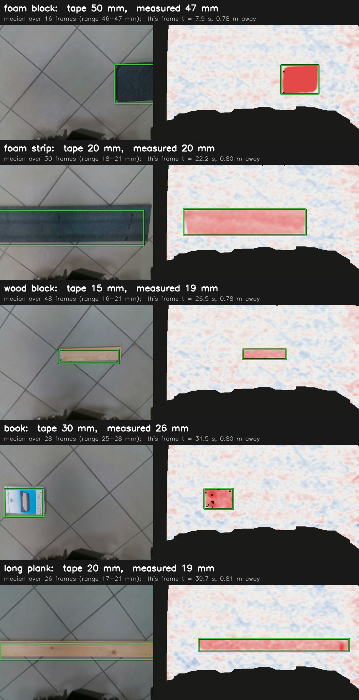
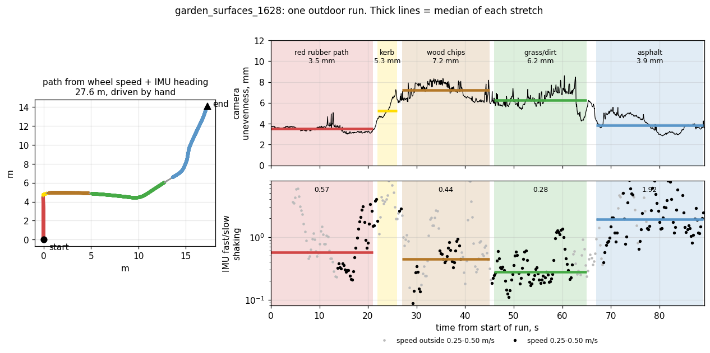
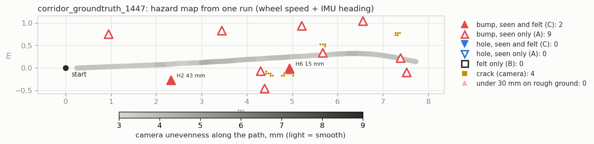
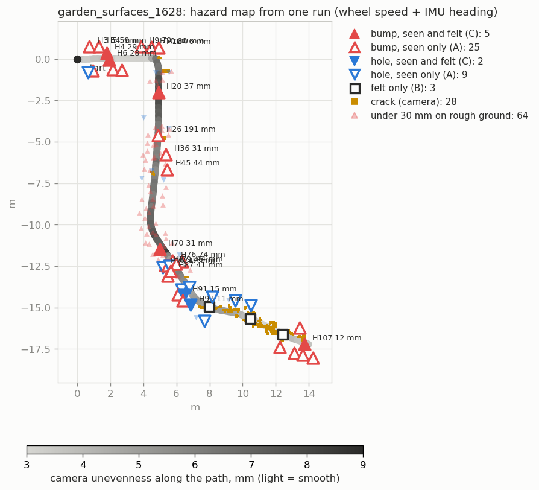
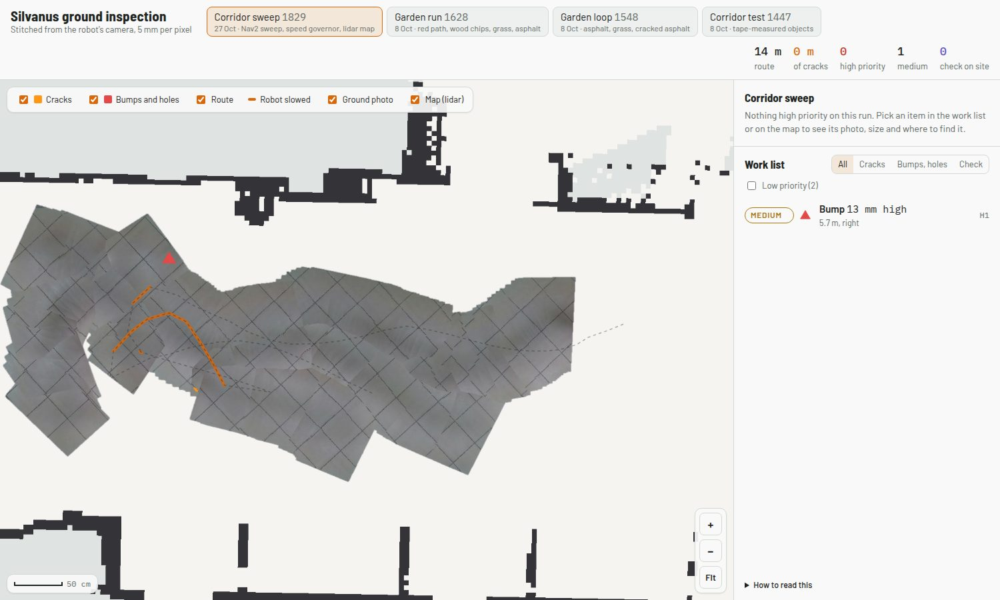
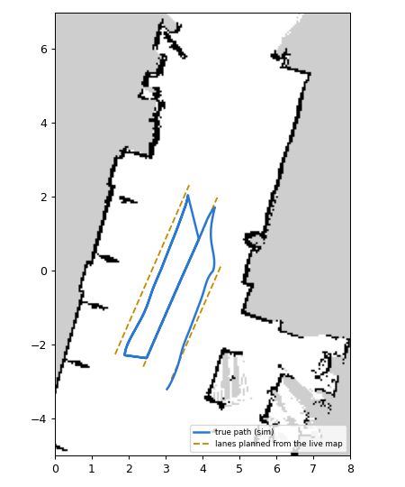

# Progress

Terrain quality and hazard mapping with Silvanus. State on 2026-10-27, against
the plan in [MILESTONES.md](MILESTONES.md). Data: [DATA.md](DATA.md).

---

## Milestones

### Week 1, 1-7 October

| Task | State |
|---|---|
| Depth pipeline running as a ROS 2 node | ✅ `ground_demo/ground_hazard_node.py`, checked live and on bags |
| `xsens_link` to `base_link` transform measured and published | ✅ [imu_mount.md](robot/imu_mount.md); IMU also raised from 10 to **100 Hz** |
| First outdoor bag, with a surface log | ✅ 5 outdoor runs; surfaces labelled from the robot camera and phone video |
| Crack model running on real frames | ✅ U-Net v1 in the ROS crack node (Aritra): cracks found in 100 % of the cracked-asphalt frames, section 5 |
| Robot body and gripper mask | ✅ depth mask; colour mask in the crack node (Aritra, bottom 80 rows) |
| Topic names and record schema agreed | draft in [schema.md](schema.md), not yet agreed |

### Week 2, 8-14 October

| Task | State |
|---|---|
| Outdoor localization tested | ✅ done offline, results below |
| Indoor map with SLAM Toolbox, AMCL on it | ✅ 27 Oct, on `/scan_fixed`: the loop closes to 1 cm (section 6) |
| IMU roughness node | the feature that works is found (below); node not written |
| Nav2 configured for the Scout | ✅ [navigation/make_nav2_robot.py](../navigation/make_nav2_robot.py) turns the lab's simulator settings into the robot's |
| RGB terrain classifier, first version | open; 5 labelled outdoor surfaces are ready |
| Annotation from our own bags | open |
| **Gate:** robot drives to a goal on a saved map | ✅ 27 Oct, goals sent from RViz |
| Week 3, started early: zigzag coverage sweep | tool written ([navigation/](../navigation/README.md)); in the lab simulator the skid-steer turns at less than half the commanded rate, so Nav2 cannot follow it yet |

### Week 3, 15-21 October

| Task | State |
|---|---|
| Speed governor between the velocity command and the base | ✅ live on the robot 27 Oct: slows, feels, stops (section 6) |
| Fusion: camera and IMU into one record every 0.25 m | ✅ offline (section 5); a live inspection page (section 6) |
| Hazard classes A, B and C assigned and stored | ✅ offline (section 5) and live in the governor (`/governor/felt`) |
| Boustrophedon sweep indoors | ✅ first sweep with Nav2 through the governor on 27 Oct; its lane-change stall is fixed and checked in simulation (section 6) |
| Vibration-based terrain classifier | open |

### Week 4, 22-28 October

| Task | State |
|---|---|
| Outdoor localization decided | wheel speed + IMU heading offline (section 4); live SLAM works indoors, not tried outdoors yet |
| Labelled outdoor runs with repeats | open |
| EKF of wheels, IMU and GPS | config ready, tested offline, not live |
| Terrain classifier on outdoor images | open |
| Map layer: path, hazard markers | ✅ inspection page with the lidar map, the route and where the robot slowed (section 6) |
| Started early, week 5: live view, the same pipeline live | the live page and the fully autonomous sweep (live SLAM, lanes planned by the robot) are written and checked in simulation and on a replay; not yet on the robot |
| **Gate:** labelled outdoor dataset | not yet |

---

## 1. Hazard detection from depth

Left the robot camera, right the height of every point above the fitted floor
(red up, blue down). Green boxes are the tape-measured objects, labelled with the
measured height and the tape height. The clip is 14 s of the slow run; the full
37 s with all five objects: [crossing_detection.mp4](media/crossing_detection.mp4).

Each object on a typical frame, with its median height over all the frames where
it is fully in view (slow run):

Tested against objects measured with a tape, 24 passes over 3 runs:

| object | tape size, L x W x H | true height | measured height |
|---|---|---|---|
| foam block | 25.5 x 20.5 x 5 cm | 50 mm | 47 mm |
| book | 20 x 14 x 3 cm | 30 mm | 26-27 mm |
| foam strip | 94-96 x 20 x 2 cm | 20 mm | 19-21 mm |
| long wooden plank | 111 x 8.2 x 2 cm | 20 mm | 18-20 mm |
| wooden block | 31.5 x 6.5 x 1.5 cm | 15 mm | 15-19 mm |

Sizes were measured with a tape in cm; heights are compared in mm (1 cm = 10 mm)
because the errors are a few mm.

**Mean error 1.7 mm, worst 4.3 mm.** Before the fix in this update it was 4.1 mm
and 9.9 mm: thin objects read high because only the pixels above the 15 mm
threshold were measured. The same object measures the same within 1-2 mm on
every pass and at both speeds. The gripper, which sits in the bottom of every
depth frame, is now masked out; that removed the false bumps and most false
holes. Details: [BRANCH_NOTES.md](../ground_demo/BRANCH_NOTES.md).

## 2. Camera predicts, IMU confirms

The camera sees each object about 4 s before the wheels reach it. When the
front wheels and then the rear wheels reach the 50 mm block, at the times
predicted from the camera and odometry, the IMU shows the two largest jolts of
the run. That is the first confirmed hazard.

- At 0.2-0.3 m/s the IMU feels rigid objects from 15 mm (wood).
- It never feels the 20 mm foam: foam squashes under the tyre.
- Above about 0.4 m/s the robot's own shaking on tile hides every object, so the
  IMU can only confirm a hazard when the robot slows down near it.

## 3. Outdoor surfaces

Top: the robot camera. Middle: what the depth camera measures on the same frame,
height above the fitted ground (white flat, red up, blue down). Asphalt and the red path
are smooth with faint stripes from the depth camera itself; wood chips and grass are
patchy. One typical frame per surface; the numbers are the medians over all runs.

| surface | camera unevenness | IMU: fast / slow shaking |
|---|---|---|
| asphalt (plain and cracked) | 3.9 mm | 2.2 |
| red rubber path | 3.6 mm | 0.51 |
| wood chips | 7.5 mm | 0.41 |
| grass / dirt | 6.8 mm | 0.29 |

Camera unevenness is the RMS height of the ground points around the fitted plane, in
each frame. For reference, the flat tile floor indoors reads 3.4-3.7 mm: that is the
depth camera's own noise. So asphalt and the red path are as flat as the camera can
tell, and grass and wood chips are clearly rougher.

Depth works in daylight: 96 % of pixels valid, floor found in every frame.

The planned roughness number, the RMS of vertical acceleration, **does not
separate surfaces**: on all of them it is about 1.0 x speed. What separates them
is which frequencies shake: power at 8-50 Hz over power at 0.5-8 Hz, at matched
speed. Hard asphalt shakes fast, soft ground slow. This needs the 100 Hz IMU; at
the old 10 Hz the 8-50 Hz band could not be seen. Asphalt vs grass from one
threshold: 97 % correct from the camera, 91 % from the IMU.

One whole run, `garden_surfaces_1628`: the path, and both roughness numbers along it.
Both change when the surface changes. The IMU number only counts at 0.25-0.50 m/s
(black dots); at other speeds it is grey.

The same run as a video, camera and height map with detections on top:
[outdoor_run_1628.mp4](media/outdoor_run_1628.mp4) (90 s).

On grass and wood chips the 15 mm threshold also boxes tufts and leaves as 12-19 mm
bumps, so off pavement the threshold has to follow the surface's unevenness.

The robot outdoors, from a phone: [robot_outdoor_1618.mp4](media/robot_outdoor_1618.mp4).

## 4. Outdoor localization

| option | result |
|---|---|
| GNSS | a fix in 3 of 5 runs, about +-7-10 m. Too coarse for hazard positions |
| Wheel odometry | misjudges turns by 15-30 deg per run (skid steer) |
| **Wheel speed + IMU heading** | **best now**: an indoor out-and-back of 26 m ends 0.4-0.7 m from the start, against 4.7 m for wheels alone |
| Lidar SLAM (SLAM Toolbox, lab config) | **fails indoors and outdoors** with the current scan, see below |

The same in ROS with `robot_localization` ([config/ekf_odom_imu.yaml](../config/ekf_odom_imu.yaml):
forward speed from the wheels, turn rate from the IMU gyro): the 26 m out-and-back
ends 0.70 m from the start (wheels 4.74 m), and the 35 m outdoor loop 0.37 m
(wheels 0.97 m). To run it live, `scout_base` must stop publishing its own
`odom -> base_footprint`, which the lab launch does not allow yet; until then the
EKF publishes `/odometry/filtered` only.

**Why SLAM fails.** `/scan` is made from the 3D lidar using all points between
-0.10 and +0.60 m above the floor, so it includes the floor. The lidar's lowest
beam hits the floor 1.4 m away, and the scan keeps the closest point in each
direction, so indoors 80 % of the scan is a ring of floor around the robot and
everything behind it is lost.

The ring moves with the robot and looks the same everywhere, so SLAM decides
the robot is not moving. Removing the ring afterwards does not help, because the
real walls and trees were already dropped when the scan was made. Nav2 would see
the same ring as an obstacle.

Fix: raise `min_height` in the lab bring-up to about +0.10 m indoors (+0.15 m
outdoors, for grass and tilt), and record `/rslidar_points` so scans can be
remade offline. Then repeat the SLAM test.

## 5. Everything on one map

[tools/analysis/hazard_map.py](../tools/analysis/hazard_map.py) runs the whole chain
offline on one bag and writes the map, `hazards.json` and `records.jsonl` in the
format of [schema.md](schema.md) (example: [results/hazard_map_1628](results/hazard_map_1628/)):

- **position**: wheel speed + IMU heading (section 4)
- **bumps and holes**: the depth detection of section 1, placed on the ground with the
  camera pose from the bag's TF (0.93 m ahead of the robot centre)
- **cracks**: Yamin's crack U-Net v1 on the colour image, three times a second (75 ms
  per frame on a laptop CPU); the crack pixels are put on the ground through the depth image
- **roughness**: camera unevenness along the path (grey: light smooth, dark rough)
- **class**: a hazard is **felt** when a wheel crosses it and the IMU jolt at that moment
  stands out from the shaking around it. A = seen only, B = felt only, C = seen and felt

On the tape-measured run all five objects are found. The 50 mm foam block (H2) and a
15 mm wooden block (H6) are **seen and felt (C)**; the 20 mm foam strips are seen
only (A), because foam squashes under the tyre. The four marks at y = 0.8-1.0 m are
the table legs beside the corridor, never driven over. No felt-only (B) hazards.

Outdoors (1628, 28 m): the raised edges of the red rubber path (58-80 mm), the kerb
(H76, 74 mm), a few real bumps on the wood chips, and the cracks along the asphalt at
the end. Bumps and holes under 30 mm on rough ground (tufts, chips) are drawn faint.
The 35 m loop is in [hazard_map_1548.png](media/hazard_map_1548.png).

What was needed to get there:

| problem | fix |
|---|---|
| A low hazard touching a wall or door frame was dropped with it (300 mm cap) | anything over 300 mm is cut out before clustering; ground-truth detections unchanged |
| On wood chips under half the points lie on one plane, giving half-image "holes" | no hazards when the plane has under 50 % inliers (42 % of wood chip frames, 0-3 % elsewhere); unevenness is still reported |
| Fixed 15 mm threshold boxed tufts and chips | threshold = max(15 mm, 3 x the frame's unevenness): unchanged on tile and asphalt, about 21 mm on grass. 1628: holes 57 -> 21 |
| The crack model marks every tile grout line | long straight lines (100 px and more) are dropped: tile keeps 3-5 % of its "cracks", the asphalt cracks 97-100 % |
| Kerb and door edges marked as cracks | crack pixels on a height step are dropped |
| One jolt credited to every tuft next to the wheel | one jolt goes to the tallest hazard the wheel crossed |

**The crack node on the robot** ([src/crack_detection](../src/crack_detection/README.md), Aritra) runs
the same U-Net live at up to 5 frames a second, with a colour mask for the gripper, and puts the
crack pixels in 3D through the depth image. Replayed on our recordings it finds cracks in 100 % of
the cracked-asphalt frames. The two false-crack filters from the map are now in the node as well:

| recording | filters off | filters on |
|---|---|---|
| cracked asphalt (1618) | crack in 100 % of frames, 2,569 px | 100 % of frames, 2,470 px (96 % kept) |
| indoor tile (1338) | 100 % of frames, 12,708 px of grout | 423 px (97 % removed) |
| tile and the door step (1536) | 1,792 px | 71 px |

**The speed governor** ([navigation/speed_governor.py](../navigation/README.md#speed-governor)) does
the same classification live. It slows the robot to 0.20 m/s before every hazard on the wheel
track, so the IMU can feel it. It stops for anything of 10 cm or more right in front, or a lidar
return 40 cm from the bumper. Once the rear wheels are past a hazard, it reports whether the jolt
made it class C or A. Replayed on the corridor run with a 0.4 m/s command, it slowed for the
foam block and found it felt (1.81 m/s², C), the same as the map.

For whoever has to fix things, [tools/inspection_viewer](../tools/inspection_viewer/README.md) shows
the same run as an inspection map: the camera frames laid on the ground and stitched into one photo
of the driven strip (5 mm per pixel), the cracks drawn on it, and a work list sorted by priority with
a photo of each item and where to find it (metres along the route, left or right).
[inspection_rviz.py](../tools/analysis/inspection_rviz.py) puts the same in RViz in 3D.

Limits of this first version:

- The felt test is calibrated at 0.2 m/s on 1447 (plain tile up to 0.65 m/s², foam 0.63-0.69,
  wood 0.81, block 1.1-1.9). At 0.4 m/s in `crossing_slow_1652` the foam strips also come out
  as felt; the threshold has to depend on speed.
- The felt-only (B) marks on asphalt (3 in 1628, 6 in 1548) are not checked against
  anything; they may be crack edges or just the asphalt's fast shaking.
- Positions drift with the wheel + IMU path, 0.4-0.7 m over 26 m (section 4).
- `garden_surfaces_1536` (door step, drain grate) has no odometry, so it cannot be mapped.

---

## 6. On the robot: map, Nav2, the governor and the first sweep (27 October)

**Indoor map.** With `/scan_fixed` (the lidar scan without the floor) SLAM Toolbox works. Three
loops of the corridor, about 22 m each. On the third the robot ended on its start tape: the first
and last lidar scans match to 4 cm without SLAM, and SLAM's end is 1 cm from that. Wheels alone
are 1.82 m off. Map: 16 x 26 m, `indoor_loop3_1316`.

**Nav2 on the saved map.** The lab's Nav2 settings are written for the simulator (sim time,
stamped velocity, the floor-seeing `/scan`, no localisation). `navigation/make_nav2_robot.py`
makes the robot's version from them: real time, plain Twist, `/scan_fixed` in its own frame, lidar
beams with no return clearing the costmap (otherwise a person who walked past stays an obstacle),
AMCL on the saved map. The robot drove to goals sent from RViz.

**The speed governor live**, driven with teleop at up to 0.3 m/s:

| test | result |
|---|---|
| lidar stop, wall ahead | stopped 0.37-0.40 m before it with the key held |
| depth stop, 123 mm and 216 mm objects | stopped 0.34-0.35 m before the front wheels |
| slow down, 10-23 mm plates | 0.30 -> 0.20 m/s before each |
| feel | felt: 10 mm (jolt 0.87 m/s²), 19 mm (1.48), 18 mm (2.65), 21 mm (1.68), 74 mm (1.28) |

One plate was often tracked as two or three pieces that shared one jolt, so all but one came out
"not felt". Pieces within 0.6 m that share a jolt are now one object (`part_of`).

**The camera pose.** The arm had been folded differently, so the camera saw the robot's front
wheels and bumper as 230-275 mm "bumps" and the governor would not let it drive.
`tools/robot/arm_to_pose.py` puts it back in Pose B through MoveIt. MoveIt first refused: in its
model the folded gripper overlapped the arm base by 18 mm. The script finds the smallest move that
gets clear with the overlap shrinking at every step (wrist -15°), then plans the rest with
collision checking. Result: all joints within 0.3° of Pose B.

**The first sweep** (`corridor_sweep_1829`): Nav2 on the saved map through the governor, two
lanes of 3 m, everything recorded. It finished, but stood 190 s at one lane change, turning back and
forth 0.23-0.5 m from the corner it had to reach. The causes, each checked in a simulation of the
robot on the real map ([tools/sim/fake_robot.py](../tools/sim/fake_robot.py): the wheels' 5 % turn
error, the lidar ray-cast from the map):

| cause | fix |
|---|---|
| every corner faced along the lane, so the next lane start sat beside the robot, which only drives forwards | every corner faces the next leg: turn on the spot, drive straight, turn |
| goal tolerance 0.20 m, under AMCL's 0.3-0.45 m spread in the corridor | 0.35 m and 30° for sweeps |
| the lab's MPPI controller circles a goal it cannot line up with | Regulated Pure Pursuit inside the Rotation Shim |
| the governor's lidar stop counted walls diagonally beside the robot | only returns in the robot's own lane count |
| slowing cut only the speed, so every curve got tighter and the robot looped | speed and turn are scaled together |

Simulated, the full 5 m x 3 lane sweep then takes 78 s with no "failed to make progress".

**The inspection page for the sweep**, placed with offline SLAM instead of wheels + IMU: the lidar
map under the stitched floor, and the route in orange where the governor slowed the robot. The first
version was poor: swirls of frames from the 190 s the robot turned at the lane change, every grout line
laid two or three times, and 15 "cracks" that were all pieces of grout. Laid flat, one frame's tiles are
square to 0.5°, but between frames SLAM's heading varied by 1-2.5° (and up to 10° while the robot
hovered) and its position by up to 10 cm. Now:

- frames only while driving: at least 5 cm/s, no turning on the spot or curves tighter than 1 m, in
  stretches of at least 0.5 m
- on a floor with a grid (tiles, paving: lines in two directions at right angles in at least half of the
  frames) the lines give each frame its heading (the median direction over all frames) and its position
  (each grout line on the same line laid before, nearest within 14 cm, under half a 30 cm tile);
  elsewhere frames are matched on edges, ±2.5° and ±6 cm, with the correction kept under 15 cm so the
  page stays on the map positions
- on a grid floor cracks must be seen in 3 frames and 40 % of the views, and nothing along the grid's
  lines counts: all 15 grout "cracks" are gone, 0 m of cracks on this floor. Outdoors nothing changes:
  `garden_surfaces_1628` keeps 11.5 m of asphalt cracks (12.9 m before) and its 12 high-priority items
- a bump within 10 cm of a wall in the lidar map is the foot of the wall
- a crossing is judged felt only while driving forward (at least 0.1 m/s, turning under 0.3 rad/s): a
  skid-steer robot turning on the spot shakes by itself. The tape-measured run 1447 is unchanged (block
  1.88 and wooden block 0.81 felt, foam strips not)

- a depth hazard counts only where the colour camera sees it too (`ground_probe.in_view`, in the live
  node and offline). The page still had three 10-13 mm "bumps" with no photo, and they were what the
  governor slowed the robot for, six times, on that run. All three sat in the outer band of the depth
  image (90° wide against 56° for colour), two in its top right corner and one at its left edge, where a
  flat floor reads 5-12 mm high; the colour camera saw plain tile. One was "felt" only because a wheel
  crossed that spot during a 0.77 jolt, just over the 0.75 limit. The colour view still reaches 0.42 m
  to each side, past the outer edge of the tyres at 0.35 m. Replayed through the live node the sweep now
  gives no slow-downs, and the tape-measured run keeps its five objects, felt as before (the foam block
  slows the robot and is felt at 1.81 m/s²); what it loses there are things 0.6-0.7 m beside the path,
  mostly the table legs. Outdoors about half the items on the 1548 and 1628 pages were seen only in that band.

The page of this run now lists nothing: 0 m of cracks, no bumps or holes. The orange stretch is where the
governor slowed the robot during the run, for those three false bumps.

**The autonomous version.** No saved map and nobody driving
([tools/robot/auto_session.sh](../tools/robot/auto_session.sh)): live SLAM, Nav2 and the governor;
the robot turns once on the spot, fits lanes 0.8 m apart into the free floor it has mapped (at least
0.6 m from walls and unknown space, up to the area it is given, [navigation/lane_planner.py](../navigation/lane_planner.py))
and sweeps them. The arm counts: in Pose B the camera housing is 1.05 m ahead of the robot centre, so
turning on the spot sweeps a circle of about 1 m. Lane ends and corners need 1.25 m free all round, the
first turn on the spot is refused when the lidar sees anything that close, Nav2's outline includes the
arm (`make_nav2_robot.py --arm-footprint`), and the governor's lidar stop is measured from the camera,
0.15 m before it. Measured from the bumper, the live test's stop at 0.40 m left the camera 7 cm past the
stop line: against a wall it would have touched. The lab's SLAM settings ignored scans while the robot turned on the spot
(`check_min_dist_and_heading_precisely: false`): the map stayed at 13 m² through a full turn and
grew to 70 m² once that was set. In simulation with a 5 x 5 m request it planned two lanes (1.6 and
3.9 m) with room for the arm to turn and swept them in 36 s. In this 3.3-4.3 m corridor that is about 9 m²
of floor instead of 21 m² without the arm; the start tape itself is only 1.05 m from a wall, so the robot
has to start 0.7 m to its left.

**The live page.** [tools/analysis/inspection_live.py](../tools/analysis/inspection_live.py) runs on
the robot and every 2 s writes the run in the viewer's format: the floor from about two colour
frames a second (laid on the map's floor plane with the camera pose from TF), the live lidar map,
the route with slow and stop stretches, and the governor's hazards with their felt verdicts.
`tools/robot/live_web.sh` serves it, and the laptop opens `http://192.168.1.102:8000`. Only these
files cross the Wi-Fi. Checked by replaying `corridor_sweep_1829` as if it were live.

**First autonomous sessions on the robot (28 October).** The stack, the hazard node, the governor,
SLAM and Nav2 all came up from `auto_session.sh`, and the live page showed the floor and a 17 mm
wooden block (32 x 7 cm, the right size). No lane was driven yet. What stopped it, each fixed and
checked in simulation since:

| on the robot | cause | fix |
|---|---|---|
| "no free floor for a lane" on open floor | SLAM Toolbox's `min_pass_through: 2`: from one spot the floor beyond about 1.5 m stays unknown, which the planner reads as a wall | `min_pass_through: 1`, and the planner adds the floor the latest scan sees (`lane_planner.add_scan`): 14 → 53 m² free from one spot in simulation |
| the turn on the spot at the start stopped after a quarter turn | Nav2 cuts a turn short when anything is inside the arm's 1 m circle, here the person at the e-stop | no turn at all: the lidar sees all round (`--spin` keeps it as an option) |
| the robot turned and reversed by itself after the governor stopped it | Nav2's own recovery: 90° turn and 0.3 m back, blind, with the arm out | `make_nav2_robot.py --wait-recovery`: clear the costmaps and wait only |
| the block twice, tiles at odd angles on the live page | frames taken while turning, laid with a lagging heading | the live page lays only frames taken while driving, as the offline page does |
| the block missing from the live page | a 17 mm bump not crossed yet is low priority, and low items were hidden | the live page shows them |
| the live page did not start | `docker cp` cannot set a file's owner on the exFAT SSD | written through `cat` |
| the planner did not start | no scipy in the robot's container | OpenCV instead |

The live page node also crashed when its canvas grew by a rounding error of one pixel (found replaying
`corridor_sweep_1829`); fixed.

**Recording.** On the internal disk the recorder dropped up to 60 % of all messages while driving
(gaps up to 3.5 s on every topic at once). Recorded to the SSD, the sweep kept the camera at 25
frames a second. `start_robot.sh` now mounts the SSD by itself and recordings go there.

---

## Problems found

| problem | effect | next step |
|---|---|---|
| `/scan` contains the floor | SLAM and Nav2 unusable | done: `/scan_fixed` (min height +0.10 m), started by our scripts; the lab bring-up still has the old one |
| The D435 reconnects as a new USB device | the container cannot see it until the stack restarts | replug, then `start_robot.sh` (a reboot was needed once) |
| Recorder stalls on the internal disk (95 % full) | up to 60 % of messages lost while driving | record to the SSD |
| Arm not in Pose B | the camera sees the robot itself | `tools/robot/arm_to_pose.py` before every session |
| Depth threshold outdoors | tufts and leaves on grass and wood chips boxed as 12-19 mm bumps | done: threshold follows the unevenness (section 5), also in the node (`rough_factor`) |
| Crack model on tile | every grout line is a crack | straight-line and step-edge filters, in the map and in the crack node; about 60 % of tile frames keep a short piece; the real fix is tile frames as negatives in the fine-tune |
| Felt test | calibrated at 0.2 m/s on one run | more crossing runs at 0.2, 0.3 and 0.4 m/s, with the governor live |
| D435 drops off USB | 5 times on 2026-10-08, after fast or rough driving | secure the cable; report to the lab |
| Wheel odometry heading | 15-30 deg error per run | fuse IMU heading with `robot_localization` |
| GNSS | +-7-10 m, no fix in 2 of 5 runs | use for rough placement only |

## Next

1. On the robot: the autonomous session indoors with the 28 October fixes, one straight lane over
   plates first (`LENGTH=3 WIDTH=0`), then the corridor, then the whole-room mode (`ROOM=1`) in a
   room without tables; then the same outdoors (live SLAM outside is still untested).
2. Crossing runs at 0.2, 0.3 and 0.4 m/s, so the felt test can depend on speed.
3. Labelled outdoor runs with repeats (the week 4 gate).
4. IMU roughness node with the frequency-band feature; EKF live.
5. Crack model fine-tuned on our frames with tile as negatives; terrain classifier on the outdoor bags.

Scripts for every figure: [tools/analysis](../tools/analysis/README.md).
