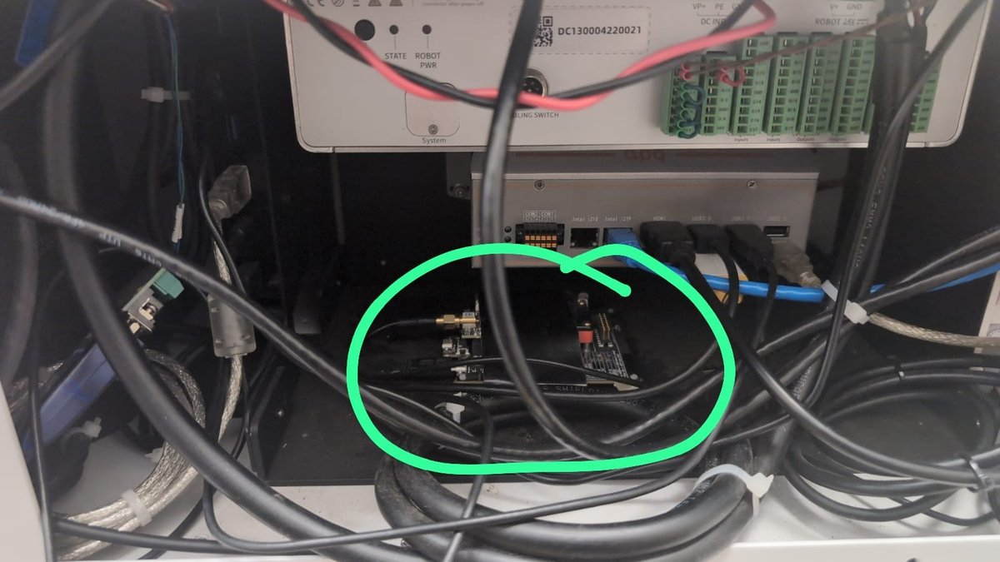
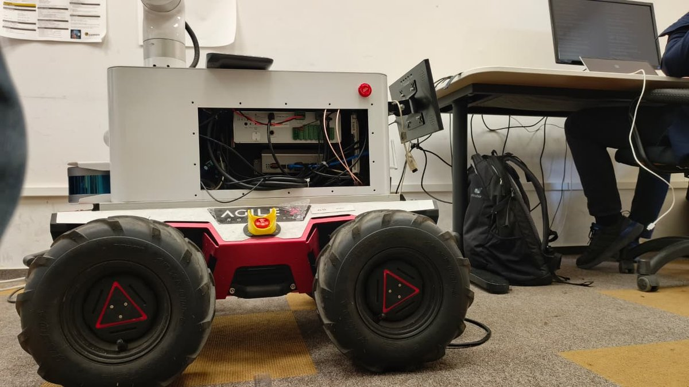
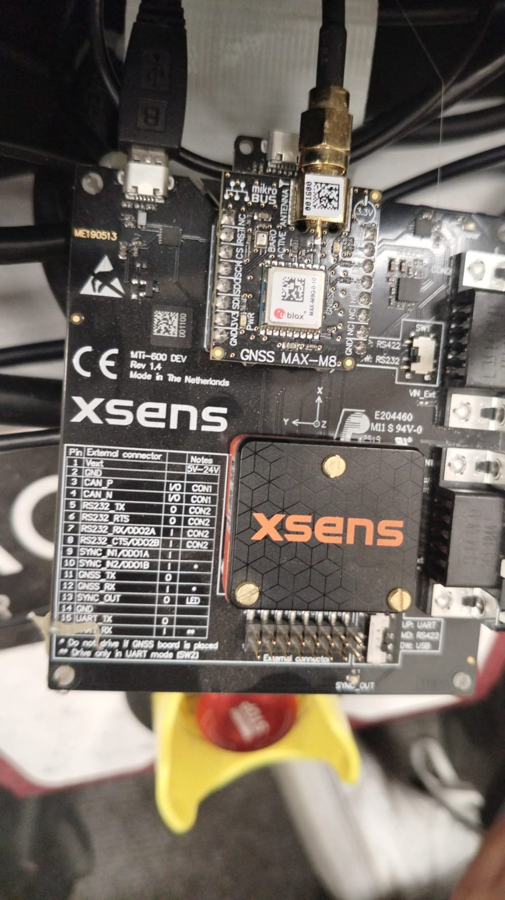

# Xsens IMU mounting transform

Silvanus, measured and verified 2026-10-08.

---

## Where it is

The Xsens MTi-670 is on an **MTi-600 DEV board** (Rev 1.4), with a u-blox
MAX-M8 GNSS receiver on a mikroBUS board beside it. It lies flat on the floor
of the white electronics box, which opens on the robot's **left** side.





The axes are printed on the board: **X towards the front (arm side), Y to the
left, Z up.** That is the same orientation as `base_link`, so no rotation is
needed.



The board is held down with adhesive tape. Check it is still firm before every
recording: if it can slide, roughness measures the board moving, not the ground.

---

## The transform

`base_link` is the centre of the four wheels, 0.2348 m above the floor.

| | value | how it was found |
|---|---|---|
| x | **0.0 m** | the module sits midway between front and rear wheels |
| y | **-0.015 m** | 26 cm to the box opening (left), 23 cm to the opposite wall; the box is centred between the wheels, so (23 - 26) / 2 = -1.5 cm |
| z | **0.115 m** | 35 cm floor to module, minus 23.48 cm |
| roll, pitch, yaw | **0** | board flat, X forward, Y left |

Measured with a tape to the middle of the small Xsens module, not the edge of
the board. Accuracy is about 1 cm.

---

## Starting the robot with it

The lab stack has no transform for the Xsens until it is given one. Give it at
**every** start, on the robot:

```bash
ls -l /dev/serial/by-id/          # find the Xsens line, note ../../ttyUSBn
cd /opt/silvanus
XSENS_BAUDRATE=921600 XSENS_PARENT_FRAME=base_link XSENS_X=0.0 XSENS_Y=-0.015 XSENS_Z=0.115 \
XSENS_ROLL=0.0 XSENS_PITCH=0.0 XSENS_YAW=0.0 \
./silvanus-up.sh --no-base --xsens=/dev/ttyUSBn --detach
```

`XSENS_BAUDRATE=921600` is required since the sensor was reconfigured (see
below). Without it the driver opens the port at 115200 and cannot talk to the
sensor.

`--no-base` is for checking only. For a normal session use the same `XSENS_...`
part in front of the start command you need from the session guide.

---

## Checks, and what they gave on 2026-10-08

From the laptop, with `source ~/workspaces/silvanus_hw_env.bash`:

**Transform**

```bash
ros2 run tf2_ros tf2_echo base_link xsens_link
```
```
- Translation: [0.000, -0.015, 0.115]
- Rotation: in RPY (degree) [0.000, -0.000, 0.000]
```

**Gravity, robot standing still**

```bash
ros2 topic echo /imu/data --field linear_acceleration
```
```
x: -0.06   y: 0.11   z: 9.80 to 9.84
```

z carries gravity, so Z points up. The small x and y mean the board sits tilted
by less than 1 degree (about 0.6 and 0.35 degrees). That changes vertical
acceleration by under 0.01 %, so roll and pitch are left at 0.

**Free acceleration**

```bash
ros2 topic hz /filter/free_acceleration
```
```
average rate: 9.8 to 10.4
```

---

## For the roughness node

`/filter/free_acceleration` (`geometry_msgs/Vector3Stamped`) is acceleration
with gravity already removed by the Xsens, in a world frame with z up. Vertical
roughness is the RMS of its z. It does not depend on the transform above.

Bags recorded before 2026-10-08 have only `/imu/data`, at 10 Hz. Record
`/filter/free_acceleration` from now on.

Measured on the robot after the change: `/imu/data` and
`/filter/free_acceleration` both **100 Hz**. Messages arrive in small bursts
(gaps of 0 to 48 ms between them), so check the spacing of the header stamps
before running an FFT on them.

---

## Sensor configuration (changed 2026-10-08)

The MTi-670 was at 10 Hz on every output, which is too slow for vibration:
an FFT sees nothing above 5 Hz and a wheel striking an edge falls between
samples. It was reconfigured with MT Manager 2022.0 from a laptop, with the
board's USB cable moved from the robot to the laptop. The settings are stored
in the sensor and survive power-off.

| Setting | Before | After |
|---|---|---|
| RS232 baudrate | 115200 | **921600** |
| UART baudrate | 115200 | **921600** |
| Xbus output: Orientation (quaternion) | 10 Hz | **100 Hz** |
| Xbus output: Inertial data (Δq, Δv, rate of turn, acceleration, free acceleration) | 10 Hz | **100 Hz** |
| Magnetic field, temperature, pressure, position and velocity | 10 Hz | 10 Hz, unchanged |
| GNSS receiver link (u-blox MAX-M8) | 115200, 4 Hz | unchanged |

Nothing was switched off, so every topic the driver published before still
exists. Device ID `0080001528`, firmware 1.0.0 build 1450.

The baudrate had to rise first: at 115200 baud the outputs above cannot fit
through the serial link at 100 Hz.

**To undo:** connect MT Manager, set both baudrates back to 115200 and the two
rows back to 10 Hz, Apply, and start the robot without `XSENS_BAUDRATE`.

MT Manager on Ubuntu 24.04 needs two old libraries (ICU 60 and
`libdouble-conversion.so.1`). A working install with a start script is at
`~/tools/xsens/` on Praveen's laptop.
