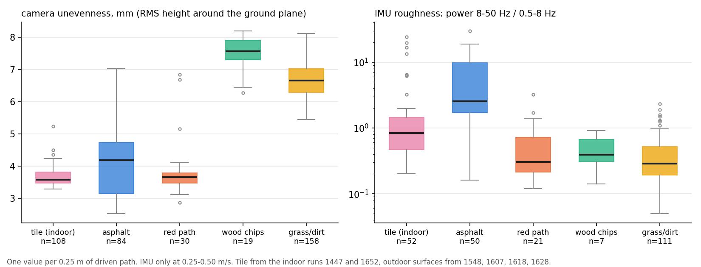
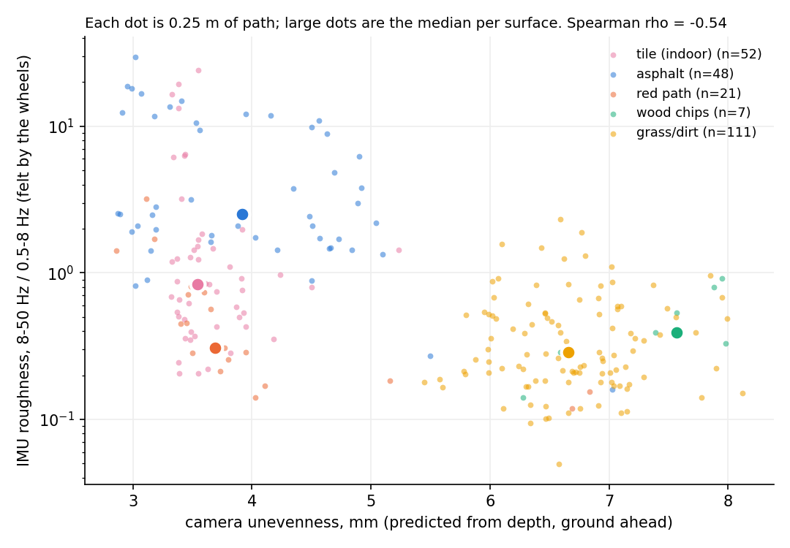
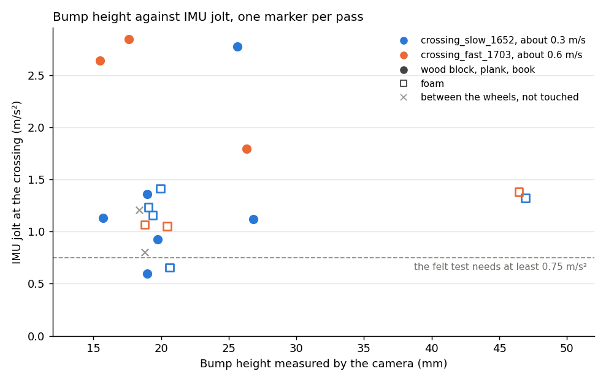

# IMU roughness node and roughness per surface

Two things: the IMU roughness node (`src/terrain_imu/`), and the figures comparing what the camera predicts with what the IMU feels, per surface. Both use the checked surface labels of the terrain classifier (`vision_training/configs/terrain_labels.yaml`).

## The IMU roughness node

Publishes on `/terrain/imu_roughness` (`std_msgs/Float32`, 4 Hz):

    power of vertical free acceleration at 8-50 Hz  /  power at 0.5-8 Hz

over the last 180 samples of `/filter/free_acceleration` (1.8 s at 100 Hz), with a Hann window. This is the calculation from `tools/analysis/outdoor_figures.py`, moved into `terrain_imu/roughness.py` so the node and the figures share one implementation (a test checks the two give the same number). Hard ground shakes the chassis fast and soft ground slowly; the plain RMS of acceleration only follows the speed.

- **NaN outside 0.25-0.50 m/s** (mean `/odom` speed over the window), because the ratio changes with speed and all our runs were compared in that range. Also NaN until 180 samples have arrived. A consumer that keeps the latest value then never carries an old number into a stretch where it means nothing.
- **Window by message count, not stamps**, because the Xsens stamps arrive in bursts (`docs/DATA.md`).
- `/terrain/imu_roughness_debug` (JSON): `{"roughness", "ratio", "speed"}`, where `ratio` is the value at any speed.

```bash
colcon build --packages-select terrain_imu && source install/setup.bash
ros2 launch terrain_imu imu_roughness.launch.py use_sim_time:=true
ros2 bag play <bags>/garden_surfaces_1628 --clock
ros2 topic echo /terrain/imu_roughness_debug
```

Needs the 100 Hz Xsens setup: bags before 8 October (1338, 1434) only have `/imu/data` at 10 Hz and no free acceleration.

**Bag replay.** `tools/analysis/surface_roughness.py` feeds the bags through the same `RoughnessWindow` class in message order and samples it at 4 Hz, exactly what the node does on a replay (`docs/results/surface_roughness/node_replay.csv`). The node itself has not been run under ROS yet (no ROS on the development laptop); its maths is tested without ROS (`python -m pytest src/terrain_imu/test`, 5 tests).

**Red path on bag 1628 (0.74 against 0.35).** Both numbers come from the same values. On 1628 the red path is in the 0.25-0.50 m/s range only from 13.9 to 21 s, about 7 s or 29 values. Until 17.4 s the ratio is about 0.3 (clean rubber); from about 18 s the path is covered in loose wood chips and leaves (camera frames at 19 and 21 s) and the ratio jumps to 1-3, before the kerb and the turn at 22 s. With the 2 s label margin that gives a median of 0.35 and a **mean of 0.75**; without the margin, a median of 0.56 and a mean of 1.03. A mean over the node's output gives Praveen's 0.74. Per bag (median, with margins): 1607 0.16, 1618 0.35, 1628 0.35. Use the median per surface, and treat the red path value as uncertain until there is a longer clean stretch at matched speed.

## Roughness per surface

Six bags with the 100 Hz IMU: outdoor 1548, 1607, 1618, 1628; indoor tile 1447 and 1652. The path is cut into pieces of 0.25 m (distance from wheel odometry). Per piece:

- **IMU roughness** when the wheels leave the piece (only at 0.25-0.50 m/s),
- **camera unevenness**: RMS height of the flat ground around the RANSAC plane, as in `outdoor_figures.py`, median over the depth frames that looked at this piece. The camera looks about 0.85 m ahead (it sees an object about 4 s before the wheels at 0.21 m/s), so a frame taken at distance s counts for the ground at s + 0.85 m,
- **surface** from the checked labels, 2 s margin at every boundary.

Data: `docs/results/surface_roughness/records.csv` (640 pieces, 410 with a surface label). Reproduce: `python tools/analysis/surface_roughness.py --bags <bags>` (about 11 minutes on a laptop CPU, no ROS).

<p align="center">
  
</p>

| Surface | Camera unevenness, median | IMU roughness, median | Node replay at 4 Hz, median | PROGRESS.md (camera, IMU) |
|---|---|---|---|---|
| tile (indoor) | 3.57 mm | 0.83 | 0.77 | n/a |
| asphalt | 4.19 mm | 2.55 | 2.88 | 3.9 mm, 2.2 |
| red path | 3.65 mm | 0.31 | 0.35 | 3.6 mm, 0.51 |
| wood chips | 7.57 mm | 0.39 | 0.40 | 7.5 mm, 0.41 |
| grass/dirt | 6.66 mm | 0.29 | 0.30 | 6.8 mm, 0.29 |

- The camera values match the published medians within 0.3 mm. IMU wood chips and grass/dirt match; asphalt and the red path differ. Two reasons: the earlier numbers were sampled every 0.25 s (slow stretches count more) and here every 0.25 m, and the labels were corrected (`docs/terrain_classifier.md`). The red path also has only 21 pieces in the speed range.
- **Camera:** tile, asphalt and the red path are flat to the camera (3.6-4.2 mm, the tile value is the sensor's noise floor); grass/dirt and wood chips are clearly uneven (6.7-7.6 mm).
- **IMU:** asphalt shakes fast (2.55), the soft surfaces slowly (0.29-0.39). Tile sits in between (0.83); its high outliers are the crossings of the wooden blocks and foam in 1652.
- **Small groups:** wood chips has only 7 pieces in the IMU speed range (most wood chips were driven slower than 0.25 m/s), and tile comes almost entirely from 1652 (1447 was driven at 0.21 m/s).

## Camera unevenness against IMU roughness

<p align="center">
  
</p>

239 pieces with both values: **Spearman rho = -0.54**. The relation is negative, and the scatter shows why: the points form two groups, not a line.

- **Hard, flat ground** (tile, asphalt, red path): 3-4 mm to the camera, IMU ratio from 0.2 to 20.
- **Soft, uneven ground** (grass/dirt, wood chips): 6-8 mm to the camera, IMU ratio mostly 0.1-1.

Within a surface the two numbers are not related either (grass/dirt rho = +0.03, n = 111; asphalt -0.35, n = 48). So the camera unevenness does not predict this IMU number. They measure different things: the camera measures the **shape** of the ground (how far points stand off a plane), the band ratio measures how **hard** it is (soft ground damps the fast shaking). Grass is uneven but soft, so it shakes the robot slowly; asphalt is flat but hard, so whatever small texture it has comes through as fast shaking.

**What this means for the project.** The two signals are complementary rather than redundant: together they separate the surfaces, which neither does alone (red path and asphalt look the same to the camera, wood chips and grass look the same to the IMU). For the claim "the camera predicts what the IMU will feel", this IMU number is the wrong partner. The planned comparison needs an IMU quantity for bumps, such as the peak vertical acceleration when crossing an object, which the crossing runs already show (`docs/PROGRESS.md` section 2).

## Crossings: bump height against the IMU jolt

For "the camera predicts what the IMU will feel" we use the jolt when a wheel crosses an object (README section 2), not the band ratio. `tools/analysis/crossing_jolts.py` does this per pass over each tape-measured object in `crossing_slow_1652` and `crossing_fast_1703` (rosbags, no ROS, about 3.5 minutes):

- **height**: the depth measurement of `eval_groundtruth.py` / `score_groundtruth.py`, median over the frames where the object is fully in view; objects and time windows from `groundtruth_objects.py`,
- **which wheel**: the object's position on the wheel + IMU path, in the robot's frame at the moment each axle passes it. A wheel runs over it when the object reaches across that wheel's track (wheels at +-0.29 m, measured length taken across the path),
- **jolt**: as in `hazard_map.py`, the largest |vertical free acceleration - its 0.5 s running median| within +-0.15 m of travel of the axle passing, and "felt" with the governor's rule.

Data: `docs/results/crossing_jolts/crossings.csv` and `summary.md`.

<p align="center">
  
</p>

| | 1652, 0.21-0.42 m/s | 1703, 0.48-0.76 m/s |
|---|---|---|
| Camera height against tape | within 4 mm on every pass | within 4 mm |
| Passes with a wheel on the object | 11 (the last foam block is never reached before the bag ends) | 6 |
| Felt (governor's rule) | 8 of 11 | 2 of 6 |
| Wooden block, 15-19 mm | 1.13, 1.36 m/s^2 | 2.64 |
| Book, 26-27 mm | 1.12, 2.78 | 1.79 |
| Long plank, 18-20 mm | 0.59, 0.93 | 2.84 |
| Foam strip, 19-21 mm | 0.66, 1.16, 1.23, 1.41 | 1.05, 1.07 |
| Foam block, 47 mm | 1.32 | 1.38 |
| Straddled (wooden block between the wheels) | 0.80, not felt | 1.21, not felt |

**What it shows.**

- **The jolt does not grow with the camera height** on these runs: Spearman rho = 0.00 over the 17 passes with a wheel on the object. The rigid objects are 15-27 mm; the only tall object is the 47 mm foam block, and foam squashes (1.3-1.4 m/s^2, the same as a 15 mm wooden block).
- **The jolt grows with speed**: rho = 0.87 (p = 0.002) for the rigid objects. A 15 mm wooden block gives 1.1-1.4 m/s^2 at 0.3 m/s and 2.6 at 0.65 m/s. The floor shakes more too, so at 0.5-0.75 m/s only 2 of 6 crossings pass the felt test.
- **Foam strips are felt at 0.26-0.42 m/s** (2 of 4 passes in 1652), unlike at 0.2 m/s in 1447. The felt threshold needs to depend on speed, as `docs/PROGRESS.md` already notes.
- **Straddled objects are not felt**, as expected: the wooden block in the middle of the path passed between the wheels both times.
- The return of `crossing_fast_1703` (30-46 s, no camera) is in the table but not in the figure. Its positions come from dead reckoning through a turn and drift about 0.4 m sideways (the same strip reads +0.03 m on the way out and -0.43 m back), enough to put the wrong wheel on an object.

**For the new recordings at 0.2, 0.3 and 0.4 m/s.** For "camera height predicts jolt" the runs need rigid objects of several heights (for example 10, 20, 30 and 50 mm wood or plates), each placed in one wheel track (about 0.29 m left or right of the robot's centre line), with a few passes per speed. Objects in the middle of the path are straddled and give no jolt, and foam is measured by the camera but barely by the IMU. With the speed fixed per run, the script then gives one height-jolt curve per speed.
