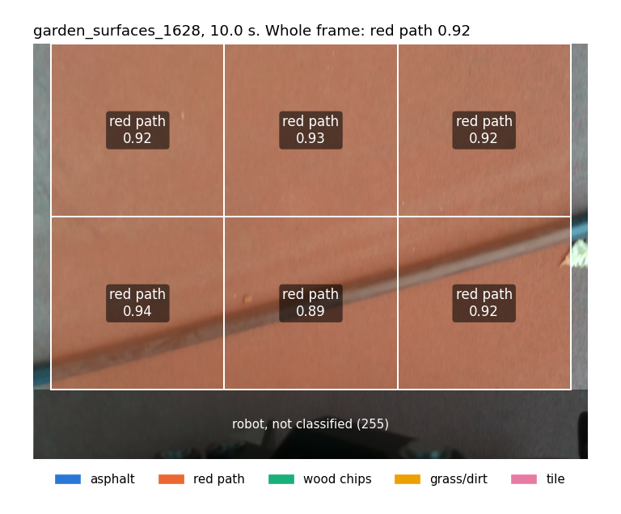
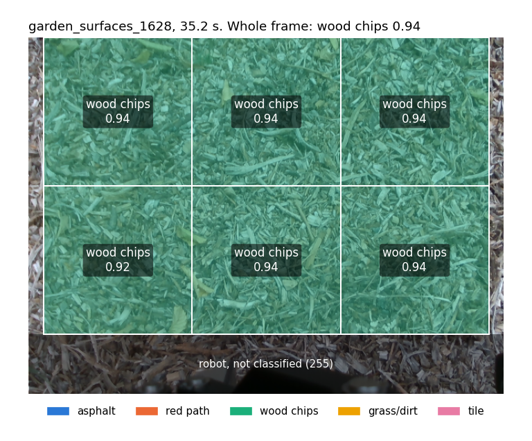
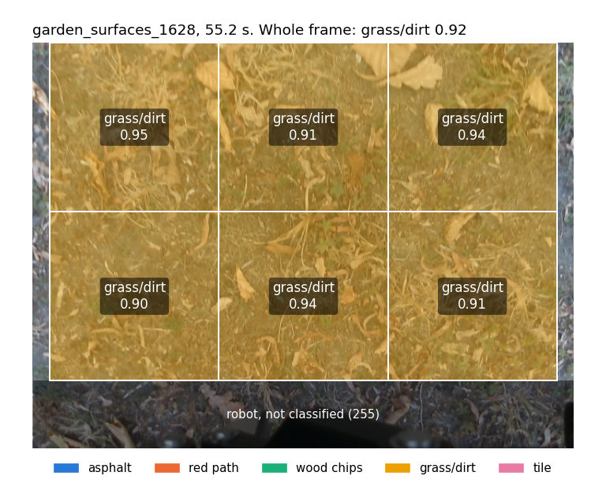
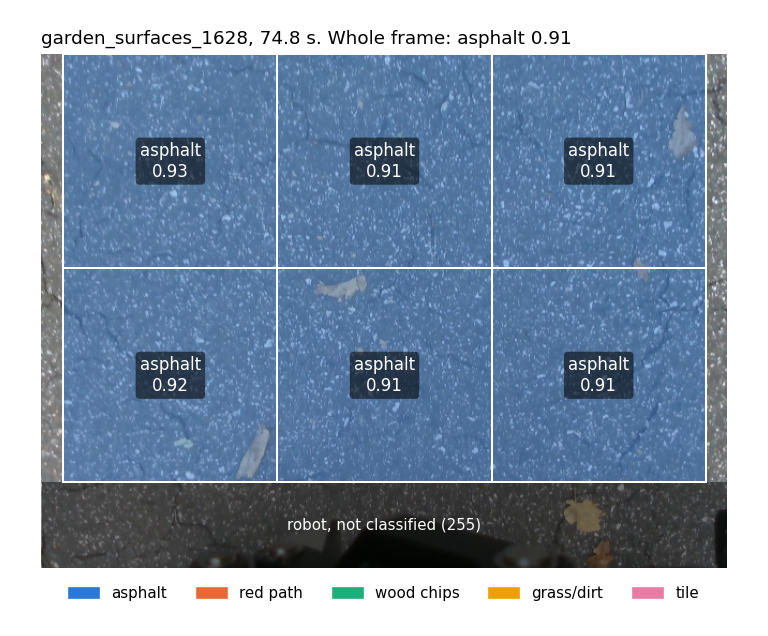
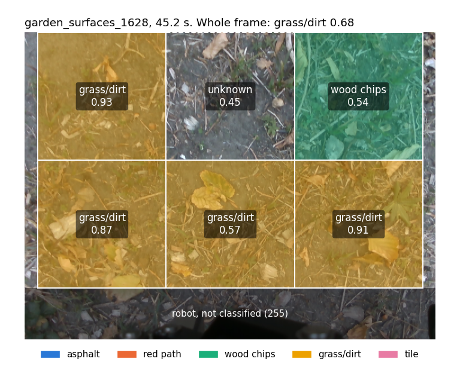
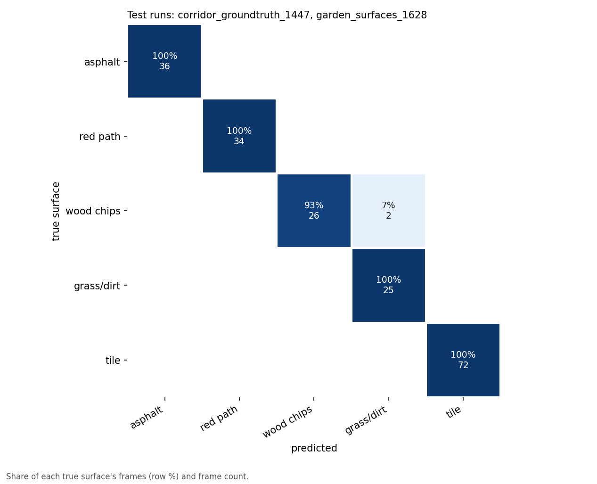
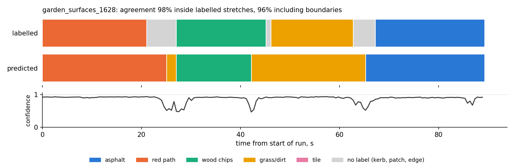

# RGB terrain classifier

Tells which surface the robot camera is looking at: asphalt, red rubber path, wood chips, grass/dirt or indoor tile. It does not measure how rough the ground is; depth unevenness and the IMU already do that. Together they give "grass, rough" or "asphalt, smooth", and the comparison of vision-only, IMU-only and combined terrain classification from the evaluation plan.

Code: `vision_training/src/terrainclf/`, scripts `vision_training/scripts/terrain_*.py`, ROS node `src/rgb_terrain/`.

## How it works

1. **Labels.** The surface time ranges from `docs/DATA.md` are copied into `vision_training/configs/terrain_labels.yaml`. Frames within 2 s of a boundary are dropped: the labels are good to a few seconds and the camera sees the next surface about a metre before the robot reaches it.
2. **Frames.** Colour frames are read straight from the `.mcap` bags with the pure-Python `rosbags` package (no ROS needed, so it runs on the GPU server), 2 per second, timed from the first colour frame like `tools/bag_to_images.py`.
3. **Patches.** Each 640x480 frame gives six 200x200 ground patches in a 2x3 grid that ends where the colour robot mask starts (row 400), so the gripper is never in a patch.
4. **Model.** MobileNetV3-small pretrained on ImageNet (1.5M parameters), fine-tuned on the patches. Classes are sampled equally often, because wood chips has far fewer frames than grass. Augmentation: random crops, flips, brightness/contrast and a little saturation; hue is kept almost fixed because colour is a real cue (the red path is red).
5. **One answer per frame.** The six patch probabilities are averaged, so a leaf or a stone in one patch does not flip the label.
6. **Testing on unseen runs.** Split by bag, never by frame. Each fold trains on every labelled bag except its test bags:

| Fold | Test bags | Why |
|---|---|---|
| `test_1628_1447` (reported) | `garden_surfaces_1628`, `corridor_groundtruth_1447` | 1628 has all four outdoor surfaces; 1447 is the indoor tile test bag, the same one the crack model uses |
| `test_1618_1338` | `garden_surfaces_1618`, `corridor_book_1338_indoor` | Second held-out run, to show how much the result depends on which run is held out |

The number of epochs (12) is fixed in advance. There is no extra validation run to tune on, so nothing is tuned on the test runs.

## Frames available (2 fps, after the 2 s margins)

Extracted on 2026-11-09 from the bags on the shared drive:

| Bag | asphalt | red path | wood chips | grass/dirt | tile |
|---|---|---|---|---|---|
| garden_surfaces_1548 | 39 | | | 78 | |
| garden_surfaces_1607 | 4 | 6 | | 44 | |
| garden_surfaces_1618 | 64 | 18 | 16 | 36 | |
| garden_surfaces_1628 | 36 | 34 | 28 | 25 | |
| corridor_book_1338_indoor | | | | | 58 |
| corridor_book_1434_indoor_books | | | | | 58 |
| corridor_groundtruth_1447 | | | | | 72 |
| crossing_slow_1652 | | | | | 172 |
| **total** | **143** | **58** | **44** | **183** | **360** |

788 frames, 271 MB of PNG. Wood chips is the weak spot: in each fold the model trains on wood chips from a single run.

**Label check.** Every segment was checked on its first, middle and last frame, and the suspicious boundaries frame by frame. Three ranges in `docs/DATA.md` are off by a few seconds and would have put wrong frames into training, so `terrain_labels.yaml` uses corrected times:

| Bag | DATA.md | What the frames show | Used |
|---|---|---|---|
| 1548 | asphalt 0-10 | 2.5-6.5 s is a mossy concrete patch | asphalt 4.5-10 |
| 1607 | grass 8-30, red path 31-44 | grass to 34.2 s, kerb 34.7-35.7 s, red path from 36 s | grass 8-34, red path 34-41 |
| 1628 | grass/dirt 46-65 | concrete patch from 62.7 s, asphalt from 66.8 s | grass/dirt 46-62.5 |

**Bags from the Drive.** Downloading the `bags` folder as one zip gives the large `.mcap` files as loose files named `<bag>_0-00N.mcap` and the rest in several zips. Put each bag back into its own folder (`<bag>/<bag>_0.mcap` plus `metadata.yaml`, the names listed in `metadata.yaml`) before running the extractor.

## Running it on the GPU server

```bash
cd /scratch2/yamin/silvanus-terrain-quality-mapping
git switch main && git pull
cd vision_training && source .venv/bin/activate
pip install torchvision --index-url https://download.pytorch.org/whl/cu121   # same CUDA build as torch
pip install -e ".[onnx,dev]"
python -m pytest
```

Either copy the extracted frames (`data/terrain/`, 271 MB) to the server and skip the extraction, or put these bag folders from the shared drive in one folder, for example `/scratch2/yamin/bags/`: `garden_surfaces_1548`, `garden_surfaces_1607`, `garden_surfaces_1618`, `garden_surfaces_1628`, `corridor_book_1338_indoor`, `corridor_book_1434_indoor_books`, `corridor_groundtruth_1447`, `crossing_slow_1652`. Each is a folder with the `.mcap` and `metadata.yaml`.

```bash
python scripts/terrain_extract.py --bags /scratch2/yamin/bags          # prints frames per surface and bag
python scripts/terrain_train.py --config configs/terrain_mobilenet.yaml  # both folds, a few minutes on the GPU
```

Results land in `runs/terrain_mnv3s_<time>/`: `summary.md` (the per-surface tables), and per fold `confusion_matrix.png`, `metrics.json`, `model.pt`.

Model for the robot, trained on all bags with the same recipe, then exported:

```bash
python scripts/terrain_train.py --config configs/terrain_mobilenet.yaml --final
python scripts/terrain_export_onnx.py --checkpoint runs/terrain_mnv3s_final_<time>/model.pt
```

Copy `rgb_terrain_v1.onnx` and `rgb_terrain_v1.json` to `src/rgb_terrain/models/`.

## On the robot

```bash
ros2 launch rgb_terrain rgb_terrain.launch.py              # live camera
ros2 launch rgb_terrain rgb_terrain.launch.py use_sim_time:=true   # with ros2 bag play --clock
```

Publishes `{"label": "grass_dirt", "confidence": 0.87}` on `/ground/rgb_terrain` at 2 Hz, or `"unknown"` when the confidence is below `min_confidence` (default 0.5). One frame takes about 28 ms on a single laptop CPU thread. Needs `onnxruntime`, which the Dockerfile already installs for the crack node.

The model files are `src/rgb_terrain/models/rgb_terrain_v1.json` (in git) and `rgb_terrain_v1.onnx` (6.1 MB, not in git; GitHub release `terrain-model-v1`, sha256 `12203c836fcc3b565680fa0f908def67d7cead2cb54ae22b679090261cca877c`). The node has been run under ROS on a bag (Praveen).

## Class mask for the costmap

The semantic segmentation costmap layer for Nav2 ([kiwicampus/semantic_segmentation_layer](https://github.com/kiwicampus/semantic_segmentation_layer), jazzy branch) needs a class per pixel, not one label per frame. The model already scores six patches per frame, so `predict_mask()` keeps each patch's answer instead of averaging them:

```python
from terrain_onnx import TerrainClassifier, UNKNOWN
clf = TerrainClassifier("rgb_terrain_v1.onnx")
mask, conf, patch_probs = clf.predict_mask(frame, bgr=False)    # full 640x480 frame, as for predict()
```

- `mask`: uint8, 480x640. Each patch box is filled with the patch's class id, in the order of `classes` in `rgb_terrain_v1.json`: asphalt 0, red_path 1, wood_chips 2, grass_dirt 3, tile 4. Everything else is 255 (`UNKNOWN`): the robot strip (rows 400-479) and the side columns 0-19 and 620-639. A patch whose best probability is below `min_confidence` (0.5, as in the node) is also 255.
- `conf`: uint8, 480x640. Each patch box holds round(best probability x 255), even for an unsure patch; 0 outside the boxes.
- `patch_probs`: float, 6x5, the softmax per patch before averaging. `predict()` is the mean of the same array, so the two always agree.

The same file is in `src/rgb_terrain/rgb_terrain/terrain_onnx.py` for the node. Tests: `python -m pytest tests/test_terrain.py` (mask shape and type, the unknown border, one class per patch box, unsure patches, agreement with `predict()`).

Examples from `garden_surfaces_1628` (`scripts/terrain_mask_examples.py`). The v1 model was trained on all labelled runs, 1628 included, so these show the output format, not accuracy (that is in the results below).

<p align="center">
  
  
  
  
</p>

On one surface all six patches agree at 0.89-0.95. At the change from wood chips to dirt (45.2 s) they do not: four patches say grass/dirt (0.57-0.93), the top middle patch is unsure (0.45, so unknown in the mask), and the top right patch, which sees green plants, says wood chips at 0.54. The frame label is grass/dirt at 0.68, so the mask holds information the single label throws away.

<p align="center">
  
</p>

Each patch covers 200x200 pixels, so the mask is coarse: about a third of the image width per cell. That matches what the costmap needs (which ground lies ahead), but a boundary between two surfaces is only placed to within one patch.

## Results (v1, 2026-11-09)

Run `runs/terrain_mnv3s_20261109_105815` on the GPU server: MobileNetV3-small, 12 epochs, about 15 s per epoch. Every number below is on runs the model never trained on, one answer per frame.

**Reported fold: test on `garden_surfaces_1628` (outdoor) and `corridor_groundtruth_1447` (indoor).** 195 frames, accuracy 99.0 %, balanced accuracy 98.6 %.

| Surface | Test frames | Accuracy | Precision |
|---|---|---|---|
| asphalt | 36 | 100 % | 100 % |
| red path | 34 | 100 % | 100 % |
| wood chips | 28 | 92.9 % | 100 % |
| grass/dirt | 25 | 100 % | 92.6 % |
| tile | 72 | 100 % | 100 % |

**Second fold: test on `garden_surfaces_1618` and `corridor_book_1338_indoor`.** 192 frames, all correct.

**Both folds together:** 387 frames, accuracy 99.5 %, balanced accuracy 99.1 %. The only mistakes are 2 wood-chip frames called grass/dirt.

<p align="center">
  
</p>

**The two mistakes.** Both are in 1628 at 42-43 s, at the end of the wood-chip stretch. The frames show the wood chips thinning out into dirt there; from 43 s it is dirt with a few chips. So the model is arguably right and the hand-written boundary (45 s) is late. The table still scores them as mistakes: moving a label after seeing the model's answer would be tuning on the test set.

**Why the score is this high, and what it does not show.**
- The five surfaces look very different from each other (the red path is red, tile is white and regular).
- The 2 s margins remove exactly the frames where two surfaces meet.
- All outdoor runs were recorded on one afternoon in one park, in the same light. Another day, wet ground or low sun has not been tested.
- So the result says the camera separates these five surfaces reliably on our recordings. It does not say how it does on surfaces or conditions it has not seen.

**Whole runs, including the boundaries.** `scripts/terrain_timeline.py` classifies every frame of a held-out run, 2 per second, including transitions and stretches without a class (kerb, concrete patch). Top band: the labels. Bottom band: the model. Below: its confidence.

<p align="center">
  
</p>

| Run (held out) | Inside the labelled stretches | Every labelled frame, boundaries included |
|---|---|---|
| garden_surfaces_1628 | 98.4 % | 96.1 % |
| garden_surfaces_1618 | 100 % | 97.0 % |

Every surface change is found, typically within 1 to 3 s of the hand-written time. Some of that offset is expected: the camera looks about a metre ahead of the robot. The confidence drops at each change (to about 0.5), which is the behaviour we want.

**Surfaces it has no class for.** `garden_surfaces_1536` was never used in training and contains ground outside the five classes. Final model, frame by frame:

| Stretch | Ground | Model says | Mean confidence |
|---|---|---|---|
| 0-5 s | tiles at the door | tile | 0.92 |
| 43-49 s | metal drain grate | mostly tile | 0.31 |
| 60-90 s | smooth concrete | asphalt | 0.92 |

Low confidence catches the drain grate, which is why the node publishes `unknown` below 0.5. Concrete is the real gap: it is called asphalt with high confidence. Adding a `concrete` class needs labelled concrete frames (1536 has about 40 s of it).

**On the robot.** The exported ONNX model gives the same logits as PyTorch (largest difference 0.00005). With the node's OpenCV resize the probabilities differ from training by at most 0.008 on `garden_surfaces_1628` (same label on 90 of 90 frames). It takes 28 ms per frame on one laptop CPU thread.

Files: `docs/media/terrain_confusion_1628_1447.png`, `terrain_confusion_pooled.png`, `terrain_timeline_1628.png`, `terrain_timeline_1618.png`, `terrain_timeline_1536_unseen_surfaces.png`.
