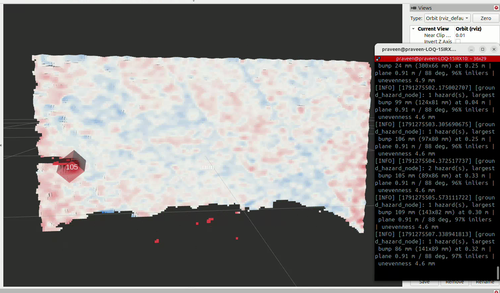
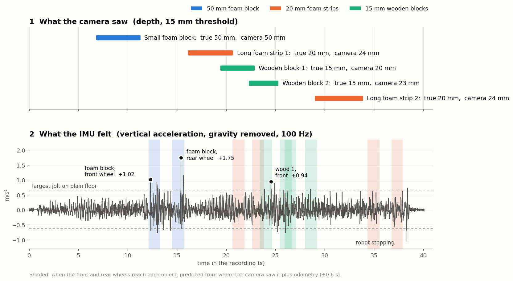

# Robot and depth geometry (Praveen)

What is on this branch and how far it has been checked.

## ground_demo/ - depth hazard detection

Depth image to point cloud, RANSAC ground plane, signed distance of every
point to that plane. Points standing off the plane are grouped into holes
(below) and bumps (above) and measured: length, width, height, area, and
distance ahead.

It also recovers the camera's height and tilt from the fitted plane, which is
how the arm pose was chosen and cross-checked.

### Validated against simulated ground truth

`python3 selftest.py` builds a plane at a known height and tilt with a known
object on it, and reports the error:

| quantity | error |
|---|---|
| camera height | better than 0.1 mm, across 0.60 to 0.90 m |
| camera tilt | better than 0.01 deg, across 35 to 50 deg |
| object size | 1.0 to 1.5 mm on 25 and 50 mm objects |

### Validated on the real robot

Run over the depth stream of `corridor_book_1434_indoor_books`:

```
camera height : 0.897 - 0.927 m      (TF independently says 0.846 m above the floor)
camera tilt   : 87.0 - 89.7 deg      (TF independently says 86.2 deg)
plane inliers : 92 - 98 %
unevenness    : 4.0 - 4.9 mm RMS on flat tile
books found   : 24-33 mm, and a taller stack at 86-119 mm
```

Two independent methods, TF and plane fitting, agree on the camera pose.

**Noise floor is about 4.5 mm on real tile**, so the hazard threshold is set at
15 mm. Anything smaller cannot be separated from sensor noise at this height.

### Three measurement choices worth knowing

A hazard is **detected** where the residual passes 15 mm, but its **height is
the median over the outline grown down to 7.5 mm** (half the threshold).
Measuring only the pixels above 15 mm keeps the top of the noise: thin objects
read 4 to 10 mm high. Against 24 tape-measured object passes (see "Depth fixes"
below) the mean error went from 4.1 mm to 1.7 mm. The old value is still
reported as `peak_mm` (90th percentile of the pixels above the threshold).

The residual field is **median filtered 5x5** before anything is measured.
Depth noise is independent per pixel, so this removes most of it while leaving
real steps intact. It takes the flat-ground noise floor from 4.2 mm to 1.1 mm
in simulation.

**The gripper is masked out.** The D435 is fixed to the gripper, so the gripper
blocks the same pixels in every arm pose: the bottom quarter of the depth image.
Its edge produces flying pixels that were read as ~100 mm bumps and false holes.
`robot_mask_d435_gripper.png` (black = robot, 15 px margin) is applied by the node;
it was made from pixels with no depth in more than 80 % of 913 frames from 4 bags.

**Hazards count only inside the colour camera's view** (`in_view`, 20 px in from
the edge of the colour image). The depth image is wider, 90 x 59 degrees against
56 x 43, and in its outer band a flat floor reads 5-12 mm high: on the corridor
sweep of 2026-10-27 that gave three false 10-13 mm bumps on plain tile, and the
speed governor slowed for them six times. The colour view still covers the wheel
tracks. The node takes the colour intrinsics from `colour_info_topic` and uses the
whole depth image until they arrive (or with an empty string).

The residual field is **median filtered 5x5** before anything is measured.
Depth noise is independent per pixel, so this removes most of it while leaving
real steps intact. It takes the flat-ground noise floor from 4.2 mm to 1.1 mm
in simulation.

### Running live: ground_hazard_node.py

The same measurement code as a ROS 2 node, against the robot or a bag replay.

| topic | type | contents |
|---|---|---|
| `/ground/hazards` | `vision_msgs/Detection3DArray` | one box per hazard: centre, size, `bump`/`hole` |
| `/ground/hazard_markers` | `visualization_msgs/MarkerArray` | the same, for RViz, labelled `bump 27 mm` |
| `/ground/unevenness` | `std_msgs/Float32` | mm RMS of the plane residual |
| `/ground/residual_cloud` | `sensor_msgs/PointCloud2` | optional, coloured blue/grey/red by signed residual |

```bash
ros2 bag play bags/corridor_book_1434_indoor_books --loop
python3 ground_hazard_node.py --ros-args -p use_sim_time:=true -p publish_cloud:=true
```

Checked against that bag: books reported at **20 to 34 mm**, the stack at
**86 to 109 mm**, plane 0.90 to 0.93 m at 87 to 89 deg, 93 to 97 % inliers,
unevenness 4.0 to 5.1 mm. Those match the offline numbers above, which is the
point of the check.



Floor coloured by signed distance to the fitted plane: blue below, white on it,
red above, full scale at 40 mm. The box is a detected hazard, labelled with its
measured height. Clip: `docs/media/first_indoor_book.mp4`.

**An open question: spurious holes.** Over the 333 processed frames of this
bag, five holes are reported on what is flat tile. Measured, they are:

| frame | size | range | area | missing depth in bbox | px to nearest bump |
|---|---|---|---|---|---|
| 72 | 59 mm | 0.95 m | 27 cm2 | 3 % | 58 |
| 99 | 19 mm | 0.92 m | 26 cm2 | 0 % | 98 |
| 188 | 21 mm | 0.95 m | 28 cm2 | 0 % | 42 |
| 188 | 21 mm | 0.95 m | 49 cm2 | 0 % | 94 |
| 208 | 27 mm | 0.93 m | 36 cm2 | 35 % | 110 |

Two explanations were tested and both fail:

*Occlusion shadow behind a book* - no. The nearest bump pixel is 42 to 110 px
away, roughly 100 to 260 mm on the ground. These are not beside anything.

*Range-dependent depth noise* - no. All five sit at 0.92 to 0.95 m, the same
range as the floor and the books. Re-running with a threshold scaled as
3 sigma of the D435 error model, `max(15 mm, 3 * 0.00378 * z^2)`, produces
byte-identical output: 5 holes, 369 bumps, same size ranges. At 0.9 m that
model gives 3.1 mm, close to the 4.5 mm measured noise floor, so 15 mm is
already about 5 sigma and nothing changes.

That leaves specular reflection on polished tile as the likeliest cause, which
is untested. **No filter has been added**, deliberately: anything that
suppresses a 19 to 59 mm hole on flat ground would also suppress a real
pothole, and potholes are the outdoor goal. The rate is 5 in 333 frames, 1.5 %.

Resolve it with ground truth rather than by tuning: place a known shallow dip
in the next recording. If it is detected correctly while these still appear,
they can be characterised honestly instead of filtered on a hunch.

**Update 2026-10-08:** with the gripper mask, **2 of the 5 are gone** (frames 72
and 208, rows 362-408: the gripper edge). The other 3 sit mid-image on the right
(columns 705-750, rows 41-301) and are still unexplained.

Three things the node must keep doing, each of which was wrong first time:

**Subscribe with `qos_profile_sensor_data`.** The camera publishes BEST_EFFORT.
A default RELIABLE subscription receives nothing at all - no error, no warning,
an empty topic.

**Clip depth to 0.30 - 1.60 m.** Past 1.6 m the D435's noise is larger than the
20 mm step being measured. Without the clip the far end of a corridor is
reported as a 12 m deep hole 37 m ahead: long-range noise taken at face value.

**Track the plane between frames.** `refine_plane` from the previous fit first,
full RANSAC only when that fails. Fitting a 6000-point sample rather than the
whole frame keeps it inside a frame interval.

`max_size_mm` (default 300, compared against `peak_mm`) drops depth dropouts at
the edge of the floor, which otherwise cluster into one hole half a metre deep.

### Ground truth run, 2026-10-08

`corridor_groundtruth_1447`: the node's measurement run offline over every
third depth frame, against tape-measured objects (see `docs/DATA.md`).

| object | true height | camera height | error |
|---|---|---|---|
| small foam block | 50 mm | 50 mm (48-52) | 0 |
| long foam strip 1 | 20 mm | 24 mm | +4 |
| long foam strip 2 | 20 mm | 24 mm | +4 |
| wooden block 1 | 15 mm | 20 mm | +5 |
| wooden block 2 | 15 mm | 23 mm | +8 |

Above the threshold the height is exact. **Objects near the 15 mm threshold
read 4 to 8 mm high**, because only the pixels above 15 mm are measured, which is
the top of the noise. Fix: segment at 15 mm, then measure the height over the
whole object outline at a lower level. Lengths and widths read 1 to 4 cm large
(the object's sides are counted). Black foam gave valid depth.

**Camera predicts, IMU confirms, first real case.** On plain floor the largest
vertical jolt in any 1.2 s window of `/filter/free_acceleration` is 0.63 m/s2.

| object | front / rear wheel jolt (m/s2) | class |
|---|---|---|
| small foam block, 50 mm | **1.02 / 1.75**, the two largest of the run | C confirmed |
| wooden block 1, 15 mm | 0.94 / 0.77 | C, probably (at the tyre edge) |
| foam strips, 20 mm | 0.47 to 0.63 | A, seen not felt: soft foam squashes |
| wooden block 2 | not crossed | A |

Crossing times are predicted from where the camera saw each object plus
odometry, front axle +0.249 m, rear -0.249 m, within +-0.6 s.



Found in the same run:

- **The gripper is in the bottom of the depth image.** It produces about 100 mm
  false bumps and all 5 false holes of this run. A robot-body mask removes them.
- **The camera looks about 10 degrees backwards** in the arm pose used
  (joint2 0.861, joint3 -2.284). It sees 0.5 to 1.2 m ahead of the robot centre,
  about 4 s of warning at 0.21 m/s.
- **Camera height disagrees by 5 cm:** TF 0.79 m, plane fit 0.84 m. The URDF
  puts the wheel centre 16.5 cm above the floor; Silvanus has larger tyres. To
  check: tape from floor to wheel centre.

### Depth fixes, 2026-10-08

Tested on all three indoor ground-truth runs (`corridor_groundtruth_1447`,
`crossing_slow_1652`, `crossing_fast_1703`): 24 passes over 5 tape-measured
objects, the gripper mask on in both columns.

| object | true | old height | new height |
|---|---|---|---|
| foam block | 50 mm | 50 | 47 |
| book | 30 mm | 33-34 | 26-27 |
| foam strip | 20 mm | 23-24 | 19-21 |
| long plank | 20 mm | 22-25 | 18-20 |
| wooden block | 15 mm | 20-25 | 15-19 |
| **all 24 passes** | | **mean error 4.1 mm, max 9.9, bias +4.1** | **mean 1.7 mm, max 4.3, bias -0.6** |

Detection is unchanged (still triggered at 15 mm), so nothing new is found or
lost. The simulated self-test size error went from +1.0-1.5 mm to -0.2-0.4 mm.
Measuring length and width from the top surface only was also tried and made
thin objects worse (wood 309 -> 354 mm, true 315), so size is unchanged.

With the mask, holes dropped 5 -> 0 (`corridor_groundtruth_1447`), 29 -> 20 and
27 -> 16 (crossing runs). Of the 36 left, 29 appear while an object is in view,
on the floor just past it, which the camera sees badly.

Reproduce: `tools/analysis/eval_groundtruth.py` then `score_groundtruth.py`.

### Next

- ~~`xsens_link` to `base_link` transform~~ Done 2026-10-08, see `docs/robot/imu_mount.md`.
- ~~Run against a bag with ruler-measured objects~~ Done, see above.
- The 3 remaining unexplained holes from 2026-10-01.
- Holes on the floor just past raised objects.

## tools/

- `bag_to_images.py` - pull colour and depth frames out of a bag at a chosen
  rate, for annotation. Consecutive frames are nearly identical, so 1 to 2 fps
  gives genuinely different images. Writes `index.csv` so the dataset can later
  be split by recording session rather than by frame.
- `silvanus_evidence.sh`, `silvanus_diag.sh` - capture evidence for the
  hardware issues reported to the lab.

## docs/robot/

- `arm_pose.md` - joint values for the ground-facing camera pose, the measured
  transform, and what is still to be measured.
- `robot_session_guide.md` - connecting, starting the stack, recording, and the
  problems found on this robot with their workarounds.
